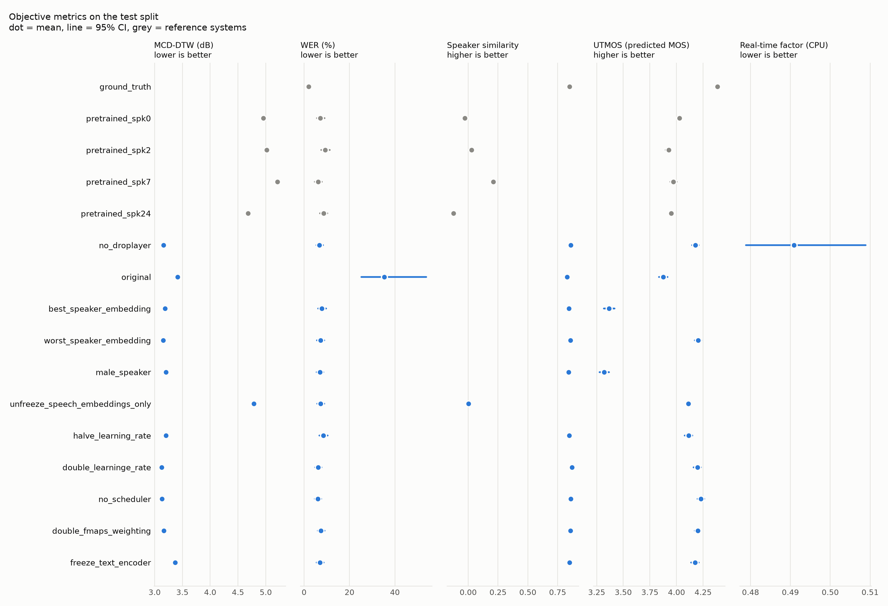
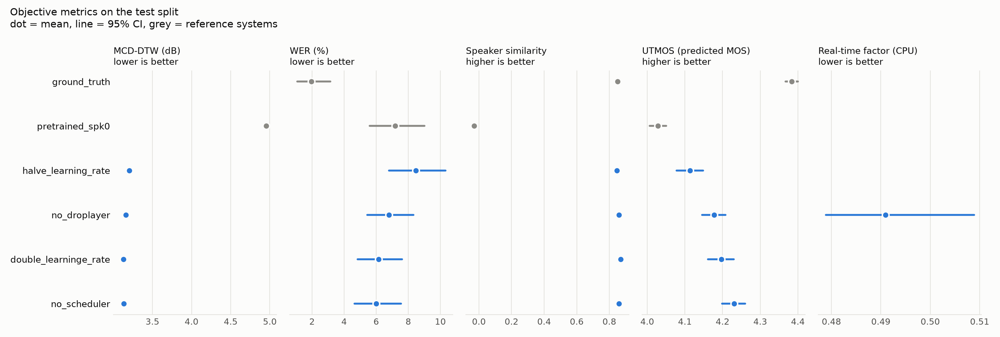
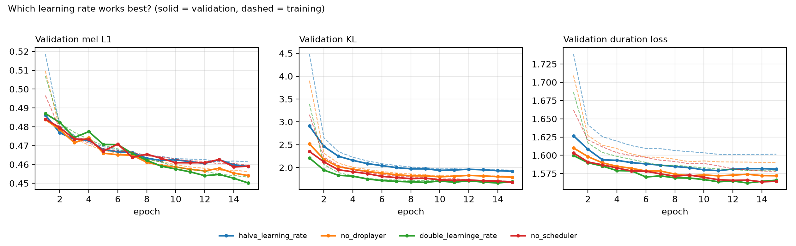
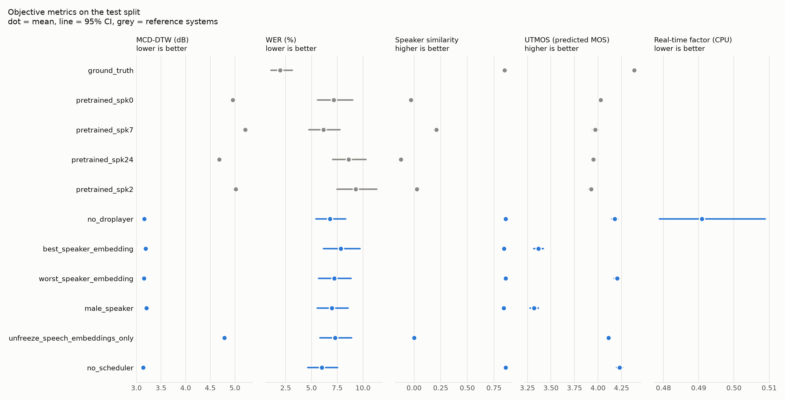
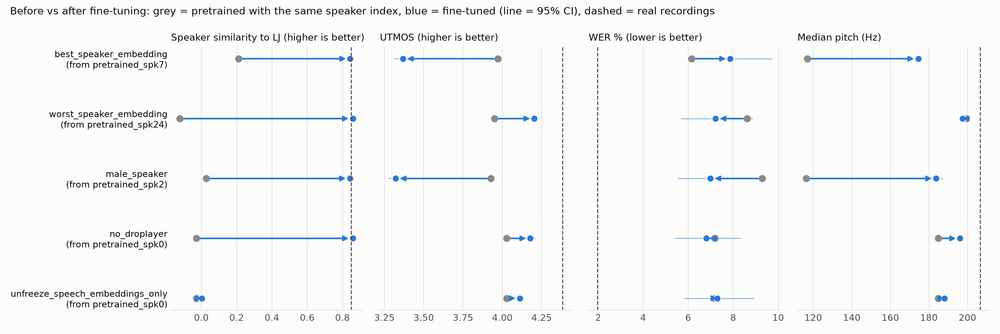
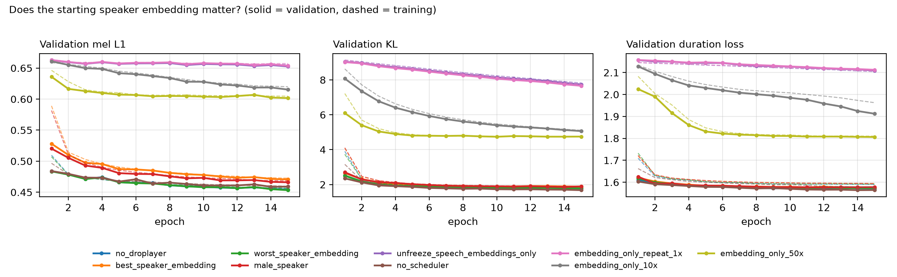
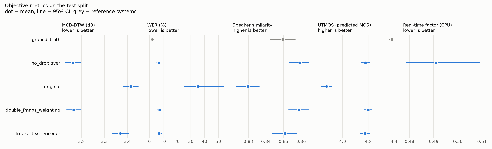
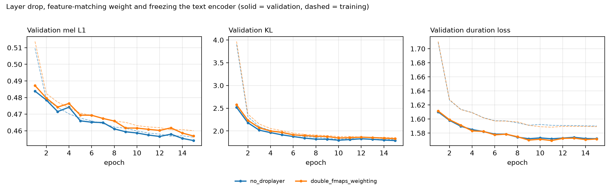

# Fine-tuning experiments: evaluation report

Generated 2026-11-05 13:53. Test sentences per system: 150 (`dataset\splits\test_manifest.csv`, test-set fingerprint e705482d0bf0). Base model: `ylacombe/vits-vctk-with-discriminator`.

Every number is a mean with a 95% bootstrap CI over the test sentences; WER and CER are corpus rates. The ceiling is the real recordings (`ground_truth`); a floor is the pretrained model with a run's speaker index (`pretrained_spk<k>`). Paired tests compare B with A on the same sentences (B minus A, Wilcoxon with Holm correction across metrics, effect size d_z). Unfinished systems are left out: none.

## Experiments

| experiment | speaker_id | learning_rate | weight_fmaps | encoder_layerdrop | freeze_mode | use_linear_lr_scheduler | description | config |
|---|---|---|---|---|---|---|---|---|
| no_droplayer | 0 | 2e-5 | 1 | 0 | none | true | Default configuration (baseline for every comparison) | configs/no_droplayer.yaml |
| original | 0 | 2e-5 | 1 | 0.1 | none | true | First configuration: text-encoder layer drop 0.1 | configs/original.yaml |
| best_speaker_embedding | 7 | 2e-5 | 1 | 0 | none | true | Starts from speaker 7, ranked closest to LJ by ECAPA (low-pitched) | configs/best_speaker_embedding.yaml |
| worst_speaker_embedding | 24 | 2e-5 | 1 | 0 | none | true | Starts from speaker 24, ranked furthest from LJ by ECAPA (high-pitched) | configs/worst_speaker_embedding.yaml |
| male_speaker | 2 | 2e-5 | 1 | 0 | none | true | Starts from speaker 2 (male) | configs/male_speaker.yaml |
| unfreeze_speech_embeddings_only | 0 | 2e-5 | 1 | 0 | unfreeze_speech_embeddings_only | false | Only the speaker embedding trains, at the same constant 2e-5 (run folder unfreeze_speech_embeddings_only; the YAML now describes a later 50x run) |  |
| halve_learning_rate | 0 | 1e-5 | 1 | 0 | none | true | Peak learning rate 1e-5 (linear warm-up and decay) | configs/halve_learning_rate.yaml |
| double_learninge_rate | 0 | 4e-5 | 1 | 0 | none | true | Peak learning rate 4e-5 (linear warm-up and decay) | configs/double_learninge_rate.yaml |
| no_scheduler | 0 | 2e-5 | 1 | 0 | none | false | Constant learning rate 2e-5 | configs/no_scheduler.yaml |
| double_fmaps_weighting | 0 | 2e-5 | 2 | 0 | none | true | Feature-matching loss weight 2 | configs/double_fmaps_weighting.yaml |
| freeze_text_encoder | 0 | 2e-5 | 1 | 0 | freeze_text_encoder | true | Text encoder frozen | configs/freeze_text_encoder.yaml |

## Checks: did each run do what its settings say?

Each checkpoint compared with the base model. The trained speaker row should move far more than any other row (the rest only shrink through weight decay); a frozen module should be unchanged.

| experiment | speaker_id | most-changed speaker row (change) | next row (change) | speaker row OK | unchanged modules | freeze OK | settings vs config | test sentences in its training split |
|---|---|---|---|---|---|---|---|---|
| no_droplayer | 0 | 0 (0.87%) | 82 (0.06%) | yes | none | yes | as configured | split not saved |
| original | 0 | 0 (0.89%) | 82 (0.06%) | yes | none | yes | as configured | split not saved |
| best_speaker_embedding | 7 | 7 (0.89%) | 82 (0.06%) | yes | none | yes | as configured | split not saved |
| worst_speaker_embedding | 24 | 24 (1.04%) | 82 (0.06%) | yes | none | yes | as configured | split not saved |
| male_speaker | 2 | 2 (1.04%) | 82 (0.06%) | yes | none | yes | as configured | split not saved |
| unfreeze_speech_embeddings_only | 0 | 0 (19.16%) | 82 (0.11%) | yes | text_encoder, duration_predictor, flow, posterior_encoder, decoder | yes | as configured | split not saved |
| halve_learning_rate | 0 | 0 (0.60%) | 92 (0.04%) | yes | none | yes | as configured | split not saved |
| double_learninge_rate | 0 | 0 (1.57%) | 82 (0.11%) | yes | none | yes | as configured | split not saved |
| no_scheduler | 0 | 0 (1.41%) | 82 (0.11%) | yes | none | yes | as configured | split not saved |
| double_fmaps_weighting | 0 | 0 (0.85%) | 82 (0.06%) | yes | none | yes | as configured | split not saved |
| freeze_text_encoder | 0 | 0 (1.02%) | 82 (0.06%) | yes | text_encoder | yes | as configured | split not saved |

## Overview: every system

| system | step | MCD-DTW (dB) | WER (%) | CER (%) | Speaker sim. | UTMOS | Duration ratio | Pitch (Hz) | RTF CPU | Latency CPU (s) | n sentences |
|---|---|---|---|---|---|---|---|---|---|---|---|
| ground_truth |  | - | 2.0 [1.1, 3.1] | 1.0 [0.3, 2.1] | 0.850 [0.842, 0.857] | 4.38 [4.37, 4.40] | - | 207 [204, 210] | - | - | 150 |
| pretrained_spk0 |  | 4.96 [4.92, 4.99] | 7.2 [5.6, 9.0] | 3.4 [2.4, 4.6] | -0.029 [-0.034, -0.024] | 4.03 [4.01, 4.05] | 0.75 [0.74, 0.76] | 185 [184, 185] | - | - | 150 |
| pretrained_spk2 |  | 5.02 [4.98, 5.05] | 9.3 [7.5, 11.3] | 4.6 [3.5, 6.0] | 0.028 [0.023, 0.032] | 3.93 [3.90, 3.95] | 0.67 [0.66, 0.68] | 116 [116, 117] | - | - | 150 |
| pretrained_spk7 |  | 5.21 [5.17, 5.25] | 6.2 [4.7, 7.8] | 2.9 [2.0, 4.0] | 0.211 [0.206, 0.215] | 3.97 [3.94, 4.00] | 0.78 [0.77, 0.79] | 117 [117, 117] | - | - | 150 |
| pretrained_spk24 |  | 4.68 [4.65, 4.72] | 8.6 [7.1, 10.3] | 4.2 [3.3, 5.4] | -0.122 [-0.128, -0.117] | 3.95 [3.93, 3.98] | 0.63 [0.62, 0.64] | 199 [199, 200] | - | - | 150 |
| no_droplayer |  | 3.16 [3.13, 3.19] | 6.8 [5.4, 8.3] | 3.2 [2.3, 4.4] | 0.859 [0.853, 0.864] | 4.18 [4.15, 4.21] | 0.93 [0.92, 0.95] | 196 [195, 197] | 0.491 [0.479, 0.509] | 2.113 ± 1.070 | 150 |
| original |  | 3.41 [3.38, 3.45] | 35.3 [25.2, 53.7] | 17.5 [13.4, 24.6] | 0.830 [0.823, 0.836] | 3.88 [3.84, 3.92] | 0.89 [0.88, 0.91] | 200 [199, 201] | - | - | 150 |
| best_speaker_embedding |  | 3.19 [3.16, 3.22] | 7.9 [6.2, 9.7] | 3.8 [2.8, 5.1] | 0.844 [0.837, 0.849] | 3.37 [3.32, 3.42] | 0.93 [0.91, 0.94] | 174 [174, 175] | - | - | 150 |
| worst_speaker_embedding |  | 3.15 [3.12, 3.19] | 7.2 [5.7, 8.8] | 3.5 [2.6, 4.7] | 0.858 [0.853, 0.864] | 4.20 [4.17, 4.23] | 0.93 [0.91, 0.95] | 197 [196, 199] | - | - | 150 |
| male_speaker |  | 3.21 [3.17, 3.24] | 7.0 [5.6, 8.6] | 3.4 [2.5, 4.6] | 0.842 [0.836, 0.848] | 3.32 [3.28, 3.37] | 0.93 [0.91, 0.95] | 184 [181, 187] | - | - | 150 |
| unfreeze_speech_embeddings_only |  | 4.79 [4.75, 4.82] | 7.3 [5.8, 8.9] | 3.2 [2.3, 4.3] | 0.002 [-0.004, 0.007] | 4.11 [4.09, 4.13] | 0.74 [0.73, 0.75] | 188 [187, 189] | - | - | 150 |
| halve_learning_rate |  | 3.20 [3.17, 3.24] | 8.5 [6.8, 10.3] | 4.0 [3.0, 5.2] | 0.847 [0.841, 0.853] | 4.11 [4.08, 4.15] | 0.92 [0.91, 0.94] | 196 [194, 197] | - | - | 150 |
| double_learninge_rate |  | 3.13 [3.10, 3.16] | 6.2 [4.8, 7.6] | 2.9 [2.0, 4.0] | 0.870 [0.865, 0.876] | 4.20 [4.16, 4.23] | 0.93 [0.92, 0.95] | 198 [197, 200] | - | - | 150 |
| no_scheduler |  | 3.14 [3.10, 3.17] | 6.0 [4.7, 7.5] | 2.9 [2.0, 4.1] | 0.860 [0.855, 0.865] | 4.23 [4.20, 4.26] | 0.96 [0.94, 0.97] | 198 [196, 199] | - | - | 150 |
| double_fmaps_weighting |  | 3.17 [3.13, 3.20] | 7.4 [6.0, 9.0] | 3.5 [2.6, 4.7] | 0.859 [0.853, 0.864] | 4.20 [4.17, 4.23] | 0.93 [0.91, 0.95] | 196 [195, 197] | - | - | 150 |
| freeze_text_encoder |  | 3.37 [3.34, 3.40] | 7.0 [5.6, 8.6] | 3.4 [2.4, 4.5] | 0.851 [0.844, 0.857] | 4.17 [4.14, 4.21] | 0.90 [0.89, 0.92] | 198 [196, 199] | - | - | 150 |

Timing (CPU): Intel64 Family 6 Model 126 Stepping 5, GenuineIntel

Clear differences from the baseline (`no_droplayer`):

| A | B | metric | B - A [95% CI] | Holm p | d_z | verdict |
|---|---|---|---|---|---|---|
| no_droplayer | original | MCD-DTW (dB) | +0.25 [+0.23, +0.27] | <0.001 | 2.15 | no_droplayer better |
| no_droplayer | original | WER (pp) | +38.0 [+18.7, +74.5] | <0.001 | 0.18 | no_droplayer better |
| no_droplayer | original | CER (pp) | +16.9 [+10.4, +28.9] | <0.001 | 0.25 | no_droplayer better |
| no_droplayer | original | Speaker sim. | -0.029 [-0.034, -0.025] | <0.001 | -1.08 | no_droplayer better |
| no_droplayer | original | Speaker sim. (paired) | -0.039 [-0.044, -0.034] | <0.001 | -1.22 | no_droplayer better |
| no_droplayer | original | UTMOS | -0.30 [-0.34, -0.26] | <0.001 | -1.19 | no_droplayer better |
| no_droplayer | original | Duration error | +0.024 [+0.018, +0.030] | <0.001 | 0.59 | no_droplayer better |
| no_droplayer | original | Pitch error (Hz) | -1.6 [-2.7, -0.5] | 0.008 | -0.22 | original better |
| no_droplayer | best_speaker_embedding | MCD-DTW (dB) | +0.03 [+0.02, +0.04] | <0.001 | 0.41 | no_droplayer better |
| no_droplayer | best_speaker_embedding | CER (pp) | +0.8 [+0.2, +1.5] | 0.045 | 0.19 | no_droplayer better |
| no_droplayer | best_speaker_embedding | Speaker sim. | -0.016 [-0.019, -0.012] | <0.001 | -0.72 | no_droplayer better |
| no_droplayer | best_speaker_embedding | Speaker sim. (paired) | -0.012 [-0.016, -0.007] | <0.001 | -0.41 | no_droplayer better |
| no_droplayer | best_speaker_embedding | UTMOS | -0.81 [-0.86, -0.76] | <0.001 | -2.78 | no_droplayer better |
| no_droplayer | best_speaker_embedding | Pitch error (Hz) | +15.4 [+13.3, +17.3] | <0.001 | 1.22 | no_droplayer better |
| no_droplayer | male_speaker | MCD-DTW (dB) | +0.04 [+0.03, +0.05] | <0.001 | 0.74 | no_droplayer better |
| no_droplayer | male_speaker | Speaker sim. | -0.017 [-0.021, -0.013] | <0.001 | -0.76 | no_droplayer better |
| no_droplayer | male_speaker | Speaker sim. (paired) | -0.015 [-0.020, -0.010] | <0.001 | -0.49 | no_droplayer better |
| no_droplayer | male_speaker | UTMOS | -0.86 [-0.90, -0.82] | <0.001 | -3.30 | no_droplayer better |
| no_droplayer | male_speaker | Pitch error (Hz) | +13.2 [+10.8, +15.6] | <0.001 | 0.88 | no_droplayer better |
| no_droplayer | unfreeze_speech_embeddings_only | MCD-DTW (dB) | +1.63 [+1.59, +1.66] | <0.001 | 8.23 | no_droplayer better |
| no_droplayer | unfreeze_speech_embeddings_only | Speaker sim. | -0.857 [-0.865, -0.849] | <0.001 | -17.08 | no_droplayer better |
| no_droplayer | unfreeze_speech_embeddings_only | Speaker sim. (paired) | -0.763 [-0.775, -0.751] | <0.001 | -10.38 | no_droplayer better |
| no_droplayer | unfreeze_speech_embeddings_only | UTMOS | -0.07 [-0.10, -0.03] | <0.001 | -0.33 | no_droplayer better |
| no_droplayer | unfreeze_speech_embeddings_only | Duration error | +0.163 [+0.152, +0.174] | <0.001 | 2.32 | no_droplayer better |
| no_droplayer | unfreeze_speech_embeddings_only | Pitch error (Hz) | +4.1 [+2.7, +5.5] | <0.001 | 0.47 | no_droplayer better |
| no_droplayer | halve_learning_rate | MCD-DTW (dB) | +0.04 [+0.03, +0.05] | <0.001 | 0.72 | no_droplayer better |
| no_droplayer | halve_learning_rate | Speaker sim. | -0.012 [-0.015, -0.009] | <0.001 | -0.61 | no_droplayer better |
| no_droplayer | halve_learning_rate | Speaker sim. (paired) | -0.013 [-0.017, -0.010] | <0.001 | -0.61 | no_droplayer better |
| no_droplayer | halve_learning_rate | UTMOS | -0.06 [-0.10, -0.03] | <0.001 | -0.30 | no_droplayer better |
| no_droplayer | halve_learning_rate | Duration error | +0.004 [+0.002, +0.007] | <0.001 | 0.27 | no_droplayer better |
| no_droplayer | double_learninge_rate | MCD-DTW (dB) | -0.03 [-0.04, -0.02] | <0.001 | -0.49 | double_learninge_rate better |
| no_droplayer | double_learninge_rate | Speaker sim. | +0.011 [+0.008, +0.014] | <0.001 | 0.66 | double_learninge_rate better |
| no_droplayer | double_learninge_rate | Speaker sim. (paired) | +0.014 [+0.011, +0.017] | <0.001 | 0.74 | double_learninge_rate better |
| no_droplayer | no_scheduler | MCD-DTW (dB) | -0.03 [-0.04, -0.02] | <0.001 | -0.38 | no_scheduler better |
| no_droplayer | no_scheduler | Speaker sim. (paired) | +0.007 [+0.003, +0.010] | 0.002 | 0.31 | no_scheduler better |
| no_droplayer | no_scheduler | UTMOS | +0.05 [+0.02, +0.08] | 0.013 | 0.26 | no_scheduler better |
| no_droplayer | no_scheduler | Duration error | -0.009 [-0.014, -0.005] | <0.001 | -0.33 | no_scheduler better |
| no_droplayer | freeze_text_encoder | MCD-DTW (dB) | +0.21 [+0.19, +0.23] | <0.001 | 1.76 | no_droplayer better |
| no_droplayer | freeze_text_encoder | Speaker sim. | -0.008 [-0.013, -0.004] | 0.004 | -0.29 | no_droplayer better |
| no_droplayer | freeze_text_encoder | Speaker sim. (paired) | -0.013 [-0.018, -0.007] | <0.001 | -0.37 | no_droplayer better |
| no_droplayer | freeze_text_encoder | Duration error | +0.015 [+0.009, +0.021] | <0.001 | 0.40 | no_droplayer better |

## Which learning rate works best?

Peak learning rates 1e-5, 2e-5 and 4e-5 with linear warm-up and decay, and a constant 2e-5. A linear schedule averages about half its peak, so the 4e-5 schedule is the closest match in average learning rate to the constant 2e-5.

| system | step | MCD-DTW (dB) | WER (%) | CER (%) | Speaker sim. | UTMOS | Duration ratio | Pitch (Hz) | RTF CPU | Latency CPU (s) | n sentences |
|---|---|---|---|---|---|---|---|---|---|---|---|
| ground_truth |  | - | 2.0 [1.1, 3.1] | 1.0 [0.3, 2.1] | 0.850 [0.842, 0.857] | 4.38 [4.37, 4.40] | - | 207 [204, 210] | - | - | 150 |
| pretrained_spk0 |  | 4.96 [4.92, 4.99] | 7.2 [5.6, 9.0] | 3.4 [2.4, 4.6] | -0.029 [-0.034, -0.024] | 4.03 [4.01, 4.05] | 0.75 [0.74, 0.76] | 185 [184, 185] | - | - | 150 |
| halve_learning_rate |  | 3.20 [3.17, 3.24] | 8.5 [6.8, 10.3] | 4.0 [3.0, 5.2] | 0.847 [0.841, 0.853] | 4.11 [4.08, 4.15] | 0.92 [0.91, 0.94] | 196 [194, 197] | - | - | 150 |
| no_droplayer |  | 3.16 [3.13, 3.19] | 6.8 [5.4, 8.3] | 3.2 [2.3, 4.4] | 0.859 [0.853, 0.864] | 4.18 [4.15, 4.21] | 0.93 [0.92, 0.95] | 196 [195, 197] | 0.491 [0.479, 0.509] | 2.113 ± 1.070 | 150 |
| double_learninge_rate |  | 3.13 [3.10, 3.16] | 6.2 [4.8, 7.6] | 2.9 [2.0, 4.0] | 0.870 [0.865, 0.876] | 4.20 [4.16, 4.23] | 0.93 [0.92, 0.95] | 198 [197, 200] | - | - | 150 |
| no_scheduler |  | 3.14 [3.10, 3.17] | 6.0 [4.7, 7.5] | 2.9 [2.0, 4.1] | 0.860 [0.855, 0.865] | 4.23 [4.20, 4.26] | 0.96 [0.94, 0.97] | 198 [196, 199] | - | - | 150 |

Timing (CPU): Intel64 Family 6 Model 126 Stepping 5, GenuineIntel

| A | B | metric | B - A [95% CI] | Holm p | d_z | verdict |
|---|---|---|---|---|---|---|
| no_droplayer | halve_learning_rate | MCD-DTW (dB) | +0.04 [+0.03, +0.05] | <0.001 | 0.72 | no_droplayer better |
| no_droplayer | halve_learning_rate | WER (pp) | +1.3 [-0.2, +3.0] | 0.147 | 0.13 | no clear difference |
| no_droplayer | halve_learning_rate | CER (pp) | +0.4 [-0.5, +1.3] | 0.134 | 0.07 | no clear difference |
| no_droplayer | halve_learning_rate | Speaker sim. | -0.012 [-0.015, -0.009] | <0.001 | -0.61 | no_droplayer better |
| no_droplayer | halve_learning_rate | Speaker sim. (paired) | -0.013 [-0.017, -0.010] | <0.001 | -0.61 | no_droplayer better |
| no_droplayer | halve_learning_rate | UTMOS | -0.06 [-0.10, -0.03] | <0.001 | -0.30 | no_droplayer better |
| no_droplayer | halve_learning_rate | Duration error | +0.004 [+0.002, +0.007] | <0.001 | 0.27 | no_droplayer better |
| no_droplayer | halve_learning_rate | Pitch error (Hz) | +0.3 [-0.4, +1.0] | 0.715 | 0.06 | no clear difference |
| no_droplayer | double_learninge_rate | MCD-DTW (dB) | -0.03 [-0.04, -0.02] | <0.001 | -0.49 | double_learninge_rate better |
| no_droplayer | double_learninge_rate | WER (pp) | -0.2 [-1.3, +1.0] | 0.444 | -0.03 | no clear difference |
| no_droplayer | double_learninge_rate | CER (pp) | -0.4 [-1.0, +0.3] | 0.444 | -0.09 | no clear difference |
| no_droplayer | double_learninge_rate | Speaker sim. | +0.011 [+0.008, +0.014] | <0.001 | 0.66 | double_learninge_rate better |
| no_droplayer | double_learninge_rate | Speaker sim. (paired) | +0.014 [+0.011, +0.017] | <0.001 | 0.74 | double_learninge_rate better |
| no_droplayer | double_learninge_rate | UTMOS | +0.02 [-0.02, +0.05] | 0.444 | 0.09 | no clear difference |
| no_droplayer | double_learninge_rate | Duration error | -0.002 [-0.005, +0.001] | 0.444 | -0.12 | no clear difference |
| no_droplayer | double_learninge_rate | Pitch error (Hz) | -1.2 [-2.0, -0.3] | 0.094 | -0.22 | no clear difference |
| no_droplayer | no_scheduler | MCD-DTW (dB) | -0.03 [-0.04, -0.02] | <0.001 | -0.38 | no_scheduler better |
| no_droplayer | no_scheduler | WER (pp) | -1.1 [-2.4, +0.3] | 0.550 | -0.12 | no clear difference |
| no_droplayer | no_scheduler | CER (pp) | -0.7 [-1.6, +0.1] | 0.604 | -0.12 | no clear difference |
| no_droplayer | no_scheduler | Speaker sim. | +0.001 [-0.002, +0.004] | 0.795 | 0.04 | no clear difference |
| no_droplayer | no_scheduler | Speaker sim. (paired) | +0.007 [+0.003, +0.010] | 0.002 | 0.31 | no_scheduler better |
| no_droplayer | no_scheduler | UTMOS | +0.05 [+0.02, +0.08] | 0.013 | 0.26 | no_scheduler better |
| no_droplayer | no_scheduler | Duration error | -0.009 [-0.014, -0.005] | <0.001 | -0.33 | no_scheduler better |
| no_droplayer | no_scheduler | Pitch error (Hz) | -0.8 [-1.7, +0.0] | 0.243 | -0.15 | no clear difference |
| no_scheduler | double_learninge_rate | MCD-DTW (dB) | -0.01 [-0.02, +0.00] | 0.426 | -0.10 | no clear difference |
| no_scheduler | double_learninge_rate | WER (pp) | +0.8 [-0.6, +2.4] | 1.000 | 0.09 | no clear difference |
| no_scheduler | double_learninge_rate | CER (pp) | +0.3 [-0.4, +1.3] | 1.000 | 0.06 | no clear difference |
| no_scheduler | double_learninge_rate | Speaker sim. | +0.010 [+0.007, +0.014] | <0.001 | 0.54 | double_learninge_rate better |
| no_scheduler | double_learninge_rate | Speaker sim. (paired) | +0.007 [+0.003, +0.011] | 0.010 | 0.27 | double_learninge_rate better |
| no_scheduler | double_learninge_rate | UTMOS | -0.03 [-0.07, +0.00] | 0.244 | -0.16 | no clear difference |
| no_scheduler | double_learninge_rate | Duration error | +0.007 [+0.003, +0.011] | 0.003 | 0.29 | no_scheduler better |
| no_scheduler | double_learninge_rate | Pitch error (Hz) | -0.3 [-1.2, +0.5] | 0.984 | -0.06 | no clear difference |

**Training logs.** Validation losses are reconstruction losses on the validation split with the model in training mode (posterior encoder, alignment from the real recording), so they complement the test metrics above rather than replace them; only mel, KL and duration are comparable between runs. A negative slope over the last epochs means the run was still improving when it stopped; under a linear schedule the learning rate is near zero by then, so a flat end is not evidence of convergence.

| run | epochs | val mel, final | val mel, min | epoch of min | val mel slope, last 3 epochs | val KL, final | val duration, final | val minus train mel |
|---|---|---|---|---|---|---|---|---|
| halve_learning_rate | 15 | 0.459 | 0.459 | 15 | -0.0018 | 1.918 | 1.581 | -0.003 |
| no_droplayer | 15 | 0.454 | 0.454 | 15 | -0.0019 | 1.788 | 1.572 | -0.002 |
| double_learninge_rate | 15 | 0.450 | 0.450 | 15 | -0.0023 | 1.690 | 1.566 | -0.003 |
| no_scheduler | 15 | 0.459 | 0.459 | 14 | -0.0018 | 1.677 | 1.564 | -0.000 |

## Does the starting speaker embedding matter?

Speakers 7 and 24 were ranked closest and furthest to LJ by ECAPA on the pretrained voices; 7 is low-pitched and 24 high-pitched. Speaker 2 is male and speaker 0 is the default. The embedding-only run trains nothing but the speaker vector (constant learning rate, the same 2e-5 as the rest of the model in that run), so comparing it with the constant-rate full run (no_scheduler) shows how much the rest of the model contributes. Its training logs are shown with a repeat run and two runs whose speaker-embedding learning rate was 10x and 50x (the 50x run's folder is named 20xLR, but its training_config.json records 50); those two have no checkpoint to score.

| system | step | MCD-DTW (dB) | WER (%) | CER (%) | Speaker sim. | UTMOS | Duration ratio | Pitch (Hz) | RTF CPU | Latency CPU (s) | n sentences |
|---|---|---|---|---|---|---|---|---|---|---|---|
| ground_truth |  | - | 2.0 [1.1, 3.1] | 1.0 [0.3, 2.1] | 0.850 [0.842, 0.857] | 4.38 [4.37, 4.40] | - | 207 [204, 210] | - | - | 150 |
| pretrained_spk0 |  | 4.96 [4.92, 4.99] | 7.2 [5.6, 9.0] | 3.4 [2.4, 4.6] | -0.029 [-0.034, -0.024] | 4.03 [4.01, 4.05] | 0.75 [0.74, 0.76] | 185 [184, 185] | - | - | 150 |
| pretrained_spk7 |  | 5.21 [5.17, 5.25] | 6.2 [4.7, 7.8] | 2.9 [2.0, 4.0] | 0.211 [0.206, 0.215] | 3.97 [3.94, 4.00] | 0.78 [0.77, 0.79] | 117 [117, 117] | - | - | 150 |
| pretrained_spk24 |  | 4.68 [4.65, 4.72] | 8.6 [7.1, 10.3] | 4.2 [3.3, 5.4] | -0.122 [-0.128, -0.117] | 3.95 [3.93, 3.98] | 0.63 [0.62, 0.64] | 199 [199, 200] | - | - | 150 |
| pretrained_spk2 |  | 5.02 [4.98, 5.05] | 9.3 [7.5, 11.3] | 4.6 [3.5, 6.0] | 0.028 [0.023, 0.032] | 3.93 [3.90, 3.95] | 0.67 [0.66, 0.68] | 116 [116, 117] | - | - | 150 |
| no_droplayer |  | 3.16 [3.13, 3.19] | 6.8 [5.4, 8.3] | 3.2 [2.3, 4.4] | 0.859 [0.853, 0.864] | 4.18 [4.15, 4.21] | 0.93 [0.92, 0.95] | 196 [195, 197] | 0.491 [0.479, 0.509] | 2.113 ± 1.070 | 150 |
| best_speaker_embedding |  | 3.19 [3.16, 3.22] | 7.9 [6.2, 9.7] | 3.8 [2.8, 5.1] | 0.844 [0.837, 0.849] | 3.37 [3.32, 3.42] | 0.93 [0.91, 0.94] | 174 [174, 175] | - | - | 150 |
| worst_speaker_embedding |  | 3.15 [3.12, 3.19] | 7.2 [5.7, 8.8] | 3.5 [2.6, 4.7] | 0.858 [0.853, 0.864] | 4.20 [4.17, 4.23] | 0.93 [0.91, 0.95] | 197 [196, 199] | - | - | 150 |
| male_speaker |  | 3.21 [3.17, 3.24] | 7.0 [5.6, 8.6] | 3.4 [2.5, 4.6] | 0.842 [0.836, 0.848] | 3.32 [3.28, 3.37] | 0.93 [0.91, 0.95] | 184 [181, 187] | - | - | 150 |
| unfreeze_speech_embeddings_only |  | 4.79 [4.75, 4.82] | 7.3 [5.8, 8.9] | 3.2 [2.3, 4.3] | 0.002 [-0.004, 0.007] | 4.11 [4.09, 4.13] | 0.74 [0.73, 0.75] | 188 [187, 189] | - | - | 150 |
| no_scheduler |  | 3.14 [3.10, 3.17] | 6.0 [4.7, 7.5] | 2.9 [2.0, 4.1] | 0.860 [0.855, 0.865] | 4.23 [4.20, 4.26] | 0.96 [0.94, 0.97] | 198 [196, 199] | - | - | 150 |

Timing (CPU): Intel64 Family 6 Model 126 Stepping 5, GenuineIntel

| A | B | metric | B - A [95% CI] | Holm p | d_z | verdict |
|---|---|---|---|---|---|---|
| best_speaker_embedding | worst_speaker_embedding | MCD-DTW (dB) | -0.03 [-0.04, -0.02] | <0.001 | -0.49 | worst_speaker_embedding better |
| best_speaker_embedding | worst_speaker_embedding | WER (pp) | -1.0 [-2.7, +0.6] | 0.925 | -0.09 | no clear difference |
| best_speaker_embedding | worst_speaker_embedding | CER (pp) | -0.6 [-1.6, +0.3] | 0.925 | -0.09 | no clear difference |
| best_speaker_embedding | worst_speaker_embedding | Speaker sim. | +0.015 [+0.011, +0.018] | <0.001 | 0.64 | worst_speaker_embedding better |
| best_speaker_embedding | worst_speaker_embedding | Speaker sim. (paired) | +0.014 [+0.010, +0.018] | <0.001 | 0.55 | worst_speaker_embedding better |
| best_speaker_embedding | worst_speaker_embedding | UTMOS | +0.84 [+0.78, +0.89] | <0.001 | 2.60 | worst_speaker_embedding better |
| best_speaker_embedding | worst_speaker_embedding | Duration error | -0.001 [-0.003, +0.002] | 0.925 | -0.04 | no clear difference |
| best_speaker_embedding | worst_speaker_embedding | Pitch error (Hz) | -16.1 [-18.2, -14.0] | <0.001 | -1.23 | worst_speaker_embedding better |
| no_droplayer | best_speaker_embedding | MCD-DTW (dB) | +0.03 [+0.02, +0.04] | <0.001 | 0.41 | no_droplayer better |
| no_droplayer | best_speaker_embedding | WER (pp) | +1.6 [+0.3, +3.2] | 0.166 | 0.18 | no clear difference |
| no_droplayer | best_speaker_embedding | CER (pp) | +0.8 [+0.2, +1.5] | 0.045 | 0.19 | no_droplayer better |
| no_droplayer | best_speaker_embedding | Speaker sim. | -0.016 [-0.019, -0.012] | <0.001 | -0.72 | no_droplayer better |
| no_droplayer | best_speaker_embedding | Speaker sim. (paired) | -0.012 [-0.016, -0.007] | <0.001 | -0.41 | no_droplayer better |
| no_droplayer | best_speaker_embedding | UTMOS | -0.81 [-0.86, -0.76] | <0.001 | -2.78 | no_droplayer better |
| no_droplayer | best_speaker_embedding | Duration error | +0.000 [-0.002, +0.003] | 0.876 | 0.03 | no clear difference |
| no_droplayer | best_speaker_embedding | Pitch error (Hz) | +15.4 [+13.3, +17.3] | <0.001 | 1.22 | no_droplayer better |
| no_droplayer | worst_speaker_embedding | MCD-DTW (dB) | -0.01 [-0.02, +0.00] | 1.000 | -0.12 | no clear difference |
| no_droplayer | worst_speaker_embedding | WER (pp) | +0.7 [-0.7, +2.0] | 1.000 | 0.08 | no clear difference |
| no_droplayer | worst_speaker_embedding | CER (pp) | +0.2 [-0.7, +1.0] | 1.000 | 0.04 | no clear difference |
| no_droplayer | worst_speaker_embedding | Speaker sim. | -0.001 [-0.004, +0.002] | 1.000 | -0.04 | no clear difference |
| no_droplayer | worst_speaker_embedding | Speaker sim. (paired) | +0.002 [-0.001, +0.005] | 1.000 | 0.11 | no clear difference |
| no_droplayer | worst_speaker_embedding | UTMOS | +0.03 [-0.01, +0.06] | 0.440 | 0.12 | no clear difference |
| no_droplayer | worst_speaker_embedding | Duration error | -0.000 [-0.002, +0.002] | 1.000 | -0.01 | no clear difference |
| no_droplayer | worst_speaker_embedding | Pitch error (Hz) | -0.8 [-1.4, -0.2] | 0.085 | -0.20 | no clear difference |
| no_droplayer | male_speaker | MCD-DTW (dB) | +0.04 [+0.03, +0.05] | <0.001 | 0.74 | no_droplayer better |
| no_droplayer | male_speaker | WER (pp) | +0.7 [-0.5, +2.0] | 1.000 | 0.09 | no clear difference |
| no_droplayer | male_speaker | CER (pp) | +0.4 [-0.2, +0.9] | 0.941 | 0.11 | no clear difference |
| no_droplayer | male_speaker | Speaker sim. | -0.017 [-0.021, -0.013] | <0.001 | -0.76 | no_droplayer better |
| no_droplayer | male_speaker | Speaker sim. (paired) | -0.015 [-0.020, -0.010] | <0.001 | -0.49 | no_droplayer better |
| no_droplayer | male_speaker | UTMOS | -0.86 [-0.90, -0.82] | <0.001 | -3.30 | no_droplayer better |
| no_droplayer | male_speaker | Duration error | +0.000 [-0.002, +0.002] | 1.000 | 0.00 | no clear difference |
| no_droplayer | male_speaker | Pitch error (Hz) | +13.2 [+10.8, +15.6] | <0.001 | 0.88 | no_droplayer better |
| pretrained_spk0 | unfreeze_speech_embeddings_only | MCD-DTW (dB) | -0.17 [-0.18, -0.16] | <0.001 | -3.02 | unfreeze_speech_embeddings_only better |
| pretrained_spk0 | unfreeze_speech_embeddings_only | WER (pp) | +0.4 [-0.8, +1.7] | 1.000 | 0.06 | no clear difference |
| pretrained_spk0 | unfreeze_speech_embeddings_only | CER (pp) | -0.1 [-0.7, +0.4] | 1.000 | -0.04 | no clear difference |
| pretrained_spk0 | unfreeze_speech_embeddings_only | Speaker sim. | +0.031 [+0.027, +0.036] | <0.001 | 1.11 | unfreeze_speech_embeddings_only better |
| pretrained_spk0 | unfreeze_speech_embeddings_only | Speaker sim. (paired) | +0.031 [+0.027, +0.036] | <0.001 | 1.03 | unfreeze_speech_embeddings_only better |
| pretrained_spk0 | unfreeze_speech_embeddings_only | UTMOS | +0.08 [+0.06, +0.10] | <0.001 | 0.69 | unfreeze_speech_embeddings_only better |
| pretrained_spk0 | unfreeze_speech_embeddings_only | Duration error | +0.012 [+0.010, +0.014] | <0.001 | 0.93 | pretrained_spk0 better |
| pretrained_spk0 | unfreeze_speech_embeddings_only | Pitch error (Hz) | -2.4 [-2.8, -1.9] | <0.001 | -0.87 | unfreeze_speech_embeddings_only better |
| unfreeze_speech_embeddings_only | no_scheduler | MCD-DTW (dB) | -1.65 [-1.69, -1.62] | <0.001 | -7.98 | no_scheduler better |
| unfreeze_speech_embeddings_only | no_scheduler | WER (pp) | -2.0 [-3.8, -0.3] | 0.134 | -0.18 | no clear difference |
| unfreeze_speech_embeddings_only | no_scheduler | CER (pp) | -0.7 [-1.7, +0.1] | 0.198 | -0.13 | no clear difference |
| unfreeze_speech_embeddings_only | no_scheduler | Speaker sim. | +0.858 [+0.850, +0.866] | <0.001 | 17.56 | no_scheduler better |
| unfreeze_speech_embeddings_only | no_scheduler | Speaker sim. (paired) | +0.770 [+0.758, +0.782] | <0.001 | 10.26 | no_scheduler better |
| unfreeze_speech_embeddings_only | no_scheduler | UTMOS | +0.12 [+0.08, +0.15] | <0.001 | 0.55 | no_scheduler better |
| unfreeze_speech_embeddings_only | no_scheduler | Duration error | -0.172 [-0.184, -0.160] | <0.001 | -2.27 | no_scheduler better |
| unfreeze_speech_embeddings_only | no_scheduler | Pitch error (Hz) | -4.9 [-6.4, -3.4] | <0.001 | -0.51 | no_scheduler better |

**How far did the speaker vector move?** The configured speaker's vector before and after fine-tuning: relative L2 change, cosine similarity, and the move as a share of the median distance between two different pretrained voices. Rows that get no gradient change by weight decay alone (the "next row" in the checks table).

| experiment | speaker_id | relative L2 change | cosine (before, after) | share of the gap to another voice | nearest pretrained voice now |
|---|---|---|---|---|---|
| no_droplayer | 0 | 0.87% | 0.99998 | 0.65% | 0 |
| best_speaker_embedding | 7 | 0.89% | 0.99997 | 0.58% | 7 |
| worst_speaker_embedding | 24 | 1.04% | 0.99997 | 0.71% | 24 |
| male_speaker | 2 | 1.04% | 0.99996 | 0.70% | 2 |
| unfreeze_speech_embeddings_only | 0 | 19.16% | 0.98198 | 14.33% | 0 |
| no_scheduler | 0 | 1.41% | 0.99996 | 1.05% | 0 |

**Training logs.** Validation losses are reconstruction losses on the validation split with the model in training mode (posterior encoder, alignment from the real recording), so they complement the test metrics above rather than replace them; only mel, KL and duration are comparable between runs. A negative slope over the last epochs means the run was still improving when it stopped; under a linear schedule the learning rate is near zero by then, so a flat end is not evidence of convergence.

Logs only (no checkpoint scored): embedding_only_repeat_1x, embedding_only_10x, embedding_only_50x.

| run | epochs | val mel, final | val mel, min | epoch of min | val mel slope, last 3 epochs | val KL, final | val duration, final | val minus train mel |
|---|---|---|---|---|---|---|---|---|
| no_droplayer | 15 | 0.454 | 0.454 | 15 | -0.0019 | 1.788 | 1.572 | -0.002 |
| best_speaker_embedding | 15 | 0.471 | 0.471 | 15 | -0.0019 | 1.883 | 1.576 | -0.002 |
| worst_speaker_embedding | 15 | 0.453 | 0.453 | 15 | -0.0025 | 1.781 | 1.573 | -0.003 |
| male_speaker | 15 | 0.466 | 0.466 | 15 | -0.0018 | 1.892 | 1.578 | -0.002 |
| unfreeze_speech_embeddings_only | 15 | 0.653 | 0.653 | 15 | -0.0004 | 7.743 | 2.109 | -0.003 |
| no_scheduler | 15 | 0.459 | 0.459 | 14 | -0.0018 | 1.677 | 1.564 | -0.000 |
| embedding_only_repeat_1x | 15 | 0.654 | 0.654 | 15 | -0.0005 | 7.661 | 2.112 | -0.004 |
| embedding_only_10x | 15 | 0.615 | 0.615 | 15 | -0.0017 | 5.066 | 1.912 | -0.005 |
| embedding_only_50x | 15 | 0.602 | 0.602 | 15 | -0.0026 | 4.750 | 1.806 | -0.003 |

## Layer drop, feature-matching weight and freezing the text encoder

Each run changes one setting from the default (no_droplayer).

| system | step | MCD-DTW (dB) | WER (%) | CER (%) | Speaker sim. | UTMOS | Duration ratio | Pitch (Hz) | RTF CPU | Latency CPU (s) | n sentences |
|---|---|---|---|---|---|---|---|---|---|---|---|
| ground_truth |  | - | 2.0 [1.1, 3.1] | 1.0 [0.3, 2.1] | 0.850 [0.842, 0.857] | 4.38 [4.37, 4.40] | - | 207 [204, 210] | - | - | 150 |
| no_droplayer |  | 3.16 [3.13, 3.19] | 6.8 [5.4, 8.3] | 3.2 [2.3, 4.4] | 0.859 [0.853, 0.864] | 4.18 [4.15, 4.21] | 0.93 [0.92, 0.95] | 196 [195, 197] | 0.491 [0.479, 0.509] | 2.113 ± 1.070 | 150 |
| original |  | 3.41 [3.38, 3.45] | 35.3 [25.2, 53.7] | 17.5 [13.4, 24.6] | 0.830 [0.823, 0.836] | 3.88 [3.84, 3.92] | 0.89 [0.88, 0.91] | 200 [199, 201] | - | - | 150 |
| double_fmaps_weighting |  | 3.17 [3.13, 3.20] | 7.4 [6.0, 9.0] | 3.5 [2.6, 4.7] | 0.859 [0.853, 0.864] | 4.20 [4.17, 4.23] | 0.93 [0.91, 0.95] | 196 [195, 197] | - | - | 150 |
| freeze_text_encoder |  | 3.37 [3.34, 3.40] | 7.0 [5.6, 8.6] | 3.4 [2.4, 4.5] | 0.851 [0.844, 0.857] | 4.17 [4.14, 4.21] | 0.90 [0.89, 0.92] | 198 [196, 199] | - | - | 150 |

Timing (CPU): Intel64 Family 6 Model 126 Stepping 5, GenuineIntel

| A | B | metric | B - A [95% CI] | Holm p | d_z | verdict |
|---|---|---|---|---|---|---|
| no_droplayer | original | MCD-DTW (dB) | +0.25 [+0.23, +0.27] | <0.001 | 2.15 | no_droplayer better |
| no_droplayer | original | WER (pp) | +38.0 [+18.7, +74.5] | <0.001 | 0.18 | no_droplayer better |
| no_droplayer | original | CER (pp) | +16.9 [+10.4, +28.9] | <0.001 | 0.25 | no_droplayer better |
| no_droplayer | original | Speaker sim. | -0.029 [-0.034, -0.025] | <0.001 | -1.08 | no_droplayer better |
| no_droplayer | original | Speaker sim. (paired) | -0.039 [-0.044, -0.034] | <0.001 | -1.22 | no_droplayer better |
| no_droplayer | original | UTMOS | -0.30 [-0.34, -0.26] | <0.001 | -1.19 | no_droplayer better |
| no_droplayer | original | Duration error | +0.024 [+0.018, +0.030] | <0.001 | 0.59 | no_droplayer better |
| no_droplayer | original | Pitch error (Hz) | -1.6 [-2.7, -0.5] | 0.008 | -0.22 | original better |
| no_droplayer | double_fmaps_weighting | MCD-DTW (dB) | +0.00 [-0.00, +0.01] | 1.000 | 0.10 | no clear difference |
| no_droplayer | double_fmaps_weighting | WER (pp) | +1.3 [+0.2, +2.5] | 0.249 | 0.18 | no clear difference |
| no_droplayer | double_fmaps_weighting | CER (pp) | +0.7 [-0.0, +1.6] | 0.333 | 0.14 | no clear difference |
| no_droplayer | double_fmaps_weighting | Speaker sim. | -0.000 [-0.003, +0.002] | 1.000 | -0.03 | no clear difference |
| no_droplayer | double_fmaps_weighting | Speaker sim. (paired) | +0.002 [-0.001, +0.005] | 0.160 | 0.12 | no clear difference |
| no_droplayer | double_fmaps_weighting | UTMOS | +0.02 [-0.00, +0.05] | 0.401 | 0.13 | no clear difference |
| no_droplayer | double_fmaps_weighting | Duration error | +0.000 [-0.001, +0.001] | 1.000 | 0.00 | no clear difference |
| no_droplayer | double_fmaps_weighting | Pitch error (Hz) | -0.0 [-0.5, +0.4] | 1.000 | -0.01 | no clear difference |
| no_droplayer | freeze_text_encoder | MCD-DTW (dB) | +0.21 [+0.19, +0.23] | <0.001 | 1.76 | no_droplayer better |
| no_droplayer | freeze_text_encoder | WER (pp) | +0.6 [-0.9, +2.1] | 1.000 | 0.06 | no clear difference |
| no_droplayer | freeze_text_encoder | CER (pp) | -0.0 [-0.9, +0.8] | 1.000 | -0.01 | no clear difference |
| no_droplayer | freeze_text_encoder | Speaker sim. | -0.008 [-0.013, -0.004] | 0.004 | -0.29 | no_droplayer better |
| no_droplayer | freeze_text_encoder | Speaker sim. (paired) | -0.013 [-0.018, -0.007] | <0.001 | -0.37 | no_droplayer better |
| no_droplayer | freeze_text_encoder | UTMOS | -0.00 [-0.04, +0.04] | 1.000 | -0.01 | no clear difference |
| no_droplayer | freeze_text_encoder | Duration error | +0.015 [+0.009, +0.021] | <0.001 | 0.40 | no_droplayer better |
| no_droplayer | freeze_text_encoder | Pitch error (Hz) | +0.6 [-0.7, +2.0] | 1.000 | 0.07 | no clear difference |

**Training logs.** Validation losses are reconstruction losses on the validation split with the model in training mode (posterior encoder, alignment from the real recording), so they complement the test metrics above rather than replace them; only mel, KL and duration are comparable between runs. A negative slope over the last epochs means the run was still improving when it stopped; under a linear schedule the learning rate is near zero by then, so a flat end is not evidence of convergence.

| run | epochs | val mel, final | val mel, min | epoch of min | val mel slope, last 3 epochs | val KL, final | val duration, final | val minus train mel |
|---|---|---|---|---|---|---|---|---|
| no_droplayer | 15 | 0.454 | 0.454 | 15 | -0.0019 | 1.788 | 1.572 | -0.002 |
| original | 15 | 0.457 | 0.457 | 15 | -0.0022 | 1.893 | 1.623 | -0.003 |
| double_fmaps_weighting | 15 | 0.457 | 0.457 | 15 | -0.0025 | 1.829 | 1.572 | -0.003 |
| freeze_text_encoder | 15 | 0.451 | 0.451 | 15 | -0.0020 | 2.176 | 1.554 | -0.003 |

## Listening

The 12 fixed prompts per system are in `<results>/<system>/prompts/` (pretrained_spk0, pretrained_spk2, pretrained_spk7, pretrained_spk24, no_droplayer, original, best_speaker_embedding, worst_speaker_embedding, male_speaker, unfreeze_speech_embeddings_only, halve_learning_rate, double_learninge_rate, no_scheduler, double_fmaps_weighting, freeze_text_encoder).
