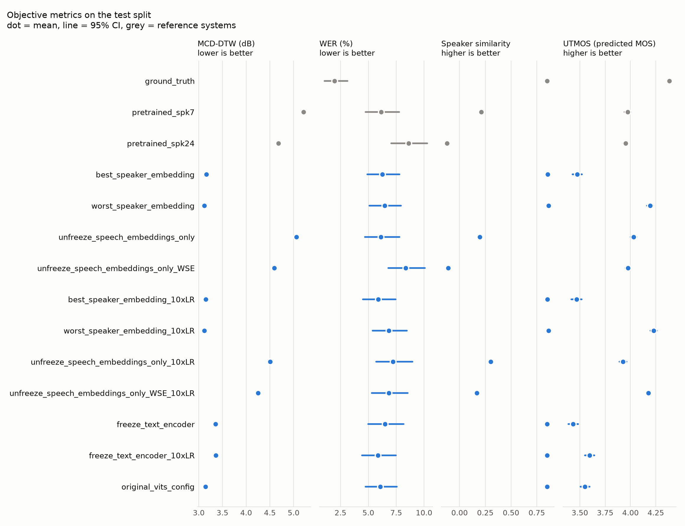
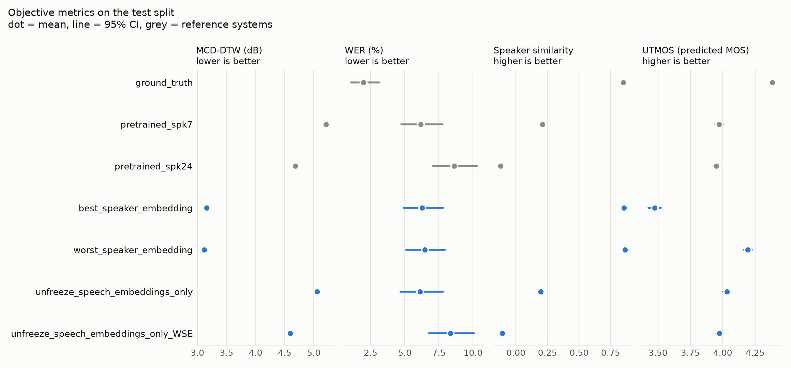
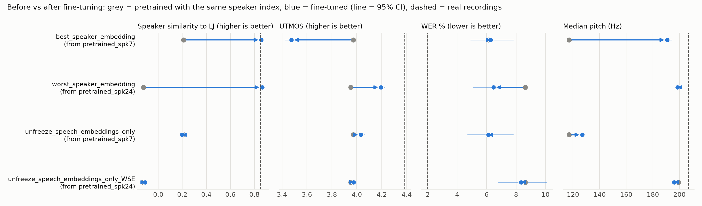
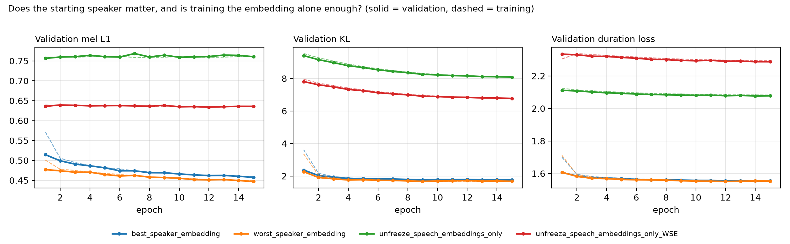
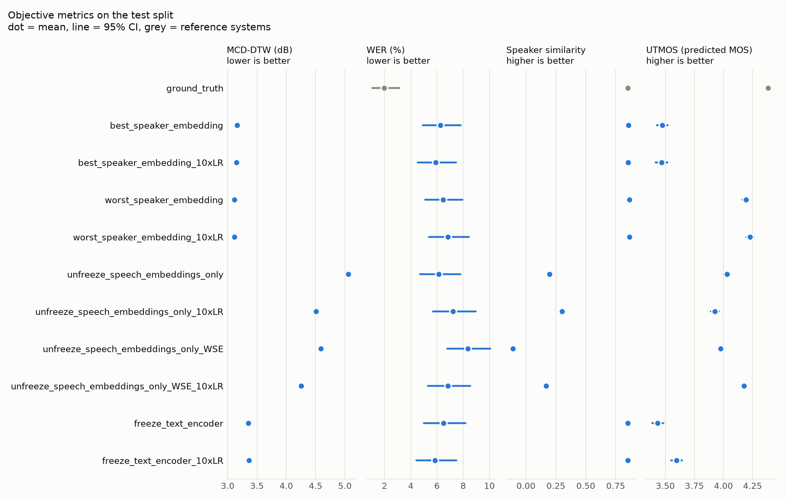
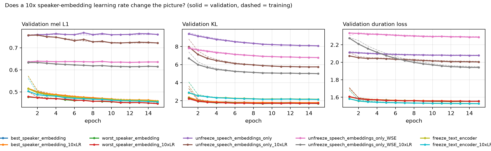
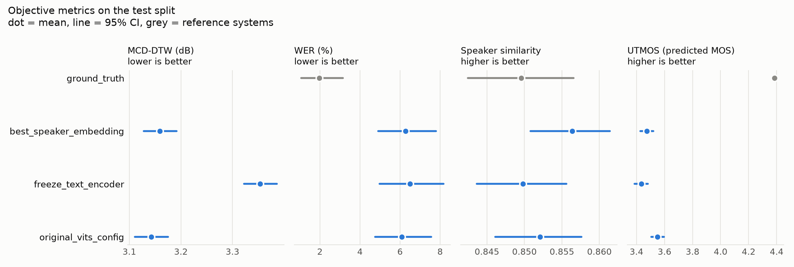
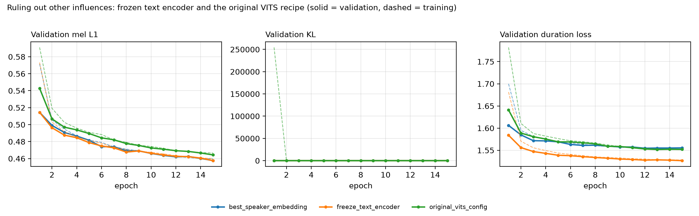

# Fine-tuning experiments: evaluation report

Generated 2026-11-05 14:12. Test sentences per system: 150 (`dataset\splits\test_manifest.csv`, test-set fingerprint e705482d0bf0). Base model: `ylacombe/vits-vctk-with-discriminator`.

Every number is a mean with a 95% bootstrap CI over the test sentences; WER and CER are corpus rates. The ceiling is the real recordings (`ground_truth`); a floor is the pretrained model with a run's speaker index (`pretrained_spk<k>`). Paired tests compare B with A on the same sentences (B minus A, Wilcoxon with Holm correction across metrics, effect size d_z). Unfinished systems are left out: none.

## Experiments

| experiment | speaker_id | learning_rate | weight_fmaps | encoder_layerdrop | freeze_mode | use_linear_lr_scheduler | speaker_embedding_lr_ratio | description | config |
|---|---|---|---|---|---|---|---|---|---|
| best_speaker_embedding | 7 | 4e-5 | 1 | 0.0 | none | true | 1.0 | Base case: speaker 7 (ECAPA-closest to LJ, male), full fine-tuning |  |
| worst_speaker_embedding | 24 | 4e-5 | 1 | 0.0 | none | true | 1.0 | Speaker 24 (ECAPA-furthest from LJ, female), full fine-tuning |  |
| unfreeze_speech_embeddings_only | 7 | 4e-5 | 1 | 0.0 | unfreeze_speech_embeddings_only | true | 1.0 | Only the speaker embedding trains, speaker 7 |  |
| unfreeze_speech_embeddings_only_WSE | 24 | 4e-5 | 1 | 0.0 | unfreeze_speech_embeddings_only | true | 1.0 | Only the speaker embedding trains, speaker 24 |  |
| best_speaker_embedding_10xLR | 7 | 4e-5 | 1 | 0.0 | none | true | 10.0 | Base case with a 10x speaker-embedding learning rate |  |
| worst_speaker_embedding_10xLR | 24 | 4e-5 | 1 | 0.0 | none | true | 10.0 | Speaker 24, full fine-tuning, 10x speaker-embedding learning rate |  |
| unfreeze_speech_embeddings_only_10xLR | 7 | 4e-5 | 1 | 0.0 | unfreeze_speech_embeddings_only | true | 10.0 | Embedding only, speaker 7, 10x speaker-embedding learning rate |  |
| unfreeze_speech_embeddings_only_WSE_10xLR | 24 | 4e-5 | 1 | 0.0 | unfreeze_speech_embeddings_only | true | 10.0 | Embedding only, speaker 24, 10x speaker-embedding learning rate |  |
| freeze_text_encoder | 7 | 4e-5 | 1 | 0.0 | freeze_text_encoder | true | 1.0 | Base case with the text encoder frozen |  |
| freeze_text_encoder_10xLR | 7 | 4e-5 | 1 | 0.0 | freeze_text_encoder | true | 10.0 | Text encoder frozen, 10x speaker-embedding learning rate |  |
| original_vits_config | 7 | 4e-5 | 1 | 0.1 | none | true | 1.0 | Base case with the original VITS recipe: text-encoder layer drop 0.1 |  |

## Checks: did each run do what its settings say?

Each checkpoint compared with the base model. The trained speaker row should move far more than any other row (the rest only shrink through weight decay); a frozen module should be unchanged.

| experiment | speaker_id | most-changed speaker row (change) | next row (change) | speaker row OK | unchanged modules | freeze OK | settings vs config | test sentences in its training split |
|---|---|---|---|---|---|---|---|---|
| best_speaker_embedding | 7 | 7 (1.56%) | 82 (0.10%) | yes | none | yes | as configured | 0 |
| worst_speaker_embedding | 24 | 24 (1.66%) | 82 (0.10%) | yes | none | yes | as configured | 0 |
| unfreeze_speech_embeddings_only | 7 | 7 (17.39%) | 82 (0.10%) | yes | text_encoder, duration_predictor, flow, posterior_encoder, decoder | yes | as configured | 0 |
| unfreeze_speech_embeddings_only_WSE | 24 | 24 (19.56%) | 82 (0.10%) | yes | text_encoder, duration_predictor, flow, posterior_encoder, decoder | yes | as configured | 0 |
| best_speaker_embedding_10xLR | 7 | 7 (12.20%) | 49 (0.97%) | yes | none | yes | as configured | 0 |
| worst_speaker_embedding_10xLR | 24 | 24 (14.82%) | 49 (0.97%) | yes | none | yes | as configured | 0 |
| unfreeze_speech_embeddings_only_10xLR | 7 | 7 (107.24%) | 49 (0.97%) | yes | text_encoder, duration_predictor, flow, posterior_encoder, decoder | yes | as configured | 0 |
| unfreeze_speech_embeddings_only_WSE_10xLR | 24 | 24 (109.10%) | 49 (0.97%) | yes | text_encoder, duration_predictor, flow, posterior_encoder, decoder | yes | as configured | 0 |
| freeze_text_encoder | 7 | 7 (1.77%) | 82 (0.10%) | yes | text_encoder | yes | as configured | 0 |
| freeze_text_encoder_10xLR | 7 | 7 (14.61%) | 49 (0.97%) | yes | text_encoder | yes | as configured | 0 |
| original_vits_config | 7 | 7 (1.59%) | 82 (0.10%) | yes | none | yes | as configured | 0 |

## Overview: every system

| system | step | MCD-DTW (dB) | WER (%) | CER (%) | Speaker sim. | UTMOS | Duration ratio | Pitch (Hz) | n sentences |
|---|---|---|---|---|---|---|---|---|---|
| ground_truth |  | - | 2.0 [1.1, 3.1] | 1.0 [0.3, 2.1] | 0.850 [0.842, 0.857] | 4.38 [4.37, 4.40] | - | 207 [204, 210] | 150 |
| pretrained_spk7 |  | 5.21 [5.17, 5.25] | 6.2 [4.7, 7.8] | 2.9 [2.0, 4.0] | 0.211 [0.206, 0.215] | 3.97 [3.94, 4.00] | 0.78 [0.77, 0.79] | 117 [117, 117] | 150 |
| pretrained_spk24 |  | 4.68 [4.65, 4.72] | 8.6 [7.1, 10.3] | 4.2 [3.3, 5.4] | -0.122 [-0.128, -0.117] | 3.95 [3.93, 3.98] | 0.63 [0.62, 0.64] | 199 [199, 200] | 150 |
| best_speaker_embedding |  | 3.16 [3.13, 3.19] | 6.3 [4.9, 7.8] | 2.8 [2.0, 3.9] | 0.856 [0.851, 0.861] | 3.47 [3.43, 3.52] | 0.92 [0.91, 0.94] | 191 [187, 194] | 150 |
| worst_speaker_embedding |  | 3.12 [3.08, 3.15] | 6.5 [5.1, 7.9] | 3.1 [2.2, 4.1] | 0.865 [0.859, 0.870] | 4.19 [4.16, 4.22] | 0.92 [0.91, 0.94] | 198 [197, 200] | 150 |
| unfreeze_speech_embeddings_only |  | 5.06 [5.02, 5.10] | 6.1 [4.7, 7.8] | 2.9 [2.0, 4.1] | 0.197 [0.193, 0.202] | 4.03 [4.00, 4.06] | 0.78 [0.77, 0.80] | 127 [127, 127] | 150 |
| unfreeze_speech_embeddings_only_WSE |  | 4.59 [4.56, 4.63] | 8.3 [6.8, 10.1] | 4.1 [3.1, 5.3] | -0.109 [-0.115, -0.104] | 3.98 [3.95, 4.00] | 0.63 [0.62, 0.65] | 196 [195, 197] | 150 |
| best_speaker_embedding_10xLR |  | 3.15 [3.12, 3.18] | 5.9 [4.5, 7.4] | 2.7 [1.9, 3.9] | 0.855 [0.848, 0.860] | 3.47 [3.42, 3.52] | 0.92 [0.91, 0.94] | 175 [173, 177] | 150 |
| worst_speaker_embedding_10xLR |  | 3.12 [3.08, 3.15] | 6.8 [5.4, 8.4] | 3.1 [2.2, 4.3] | 0.865 [0.860, 0.870] | 4.23 [4.20, 4.26] | 0.92 [0.91, 0.94] | 197 [195, 198] | 150 |
| unfreeze_speech_embeddings_only_10xLR |  | 4.51 [4.47, 4.54] | 7.2 [5.7, 9.0] | 3.4 [2.5, 4.6] | 0.302 [0.294, 0.310] | 3.93 [3.89, 3.96] | 0.79 [0.78, 0.81] | 164 [163, 164] | 150 |
| unfreeze_speech_embeddings_only_WSE_10xLR |  | 4.25 [4.22, 4.29] | 6.8 [5.3, 8.5] | 3.3 [2.3, 4.4] | 0.169 [0.161, 0.178] | 4.18 [4.15, 4.20] | 0.75 [0.74, 0.76] | 200 [199, 201] | 150 |
| freeze_text_encoder |  | 3.35 [3.32, 3.39] | 6.5 [5.0, 8.2] | 3.0 [2.0, 4.2] | 0.850 [0.844, 0.856] | 3.43 [3.39, 3.48] | 0.91 [0.90, 0.93] | 182 [179, 185] | 150 |
| freeze_text_encoder_10xLR |  | 3.36 [3.33, 3.39] | 5.9 [4.4, 7.5] | 2.7 [1.8, 3.9] | 0.851 [0.845, 0.856] | 3.60 [3.55, 3.64] | 0.91 [0.90, 0.93] | 211 [209, 214] | 150 |
| original_vits_config |  | 3.14 [3.11, 3.17] | 6.1 [4.8, 7.6] | 3.0 [2.2, 4.2] | 0.852 [0.846, 0.858] | 3.55 [3.51, 3.60] | 0.92 [0.91, 0.94] | 177 [176, 177] | 150 |

Clear differences from the baseline (`best_speaker_embedding`):

| A | B | metric | B - A [95% CI] | Holm p | d_z | verdict |
|---|---|---|---|---|---|---|
| best_speaker_embedding | worst_speaker_embedding | MCD-DTW (dB) | -0.04 [-0.05, -0.03] | <0.001 | -0.63 | worst_speaker_embedding better |
| best_speaker_embedding | worst_speaker_embedding | Speaker sim. | +0.008 [+0.005, +0.011] | <0.001 | 0.44 | worst_speaker_embedding better |
| best_speaker_embedding | worst_speaker_embedding | Speaker sim. (paired) | +0.009 [+0.005, +0.013] | <0.001 | 0.39 | worst_speaker_embedding better |
| best_speaker_embedding | worst_speaker_embedding | UTMOS | +0.72 [+0.67, +0.77] | <0.001 | 2.39 | worst_speaker_embedding better |
| best_speaker_embedding | worst_speaker_embedding | Pitch error (Hz) | -10.9 [-13.4, -8.3] | <0.001 | -0.69 | worst_speaker_embedding better |
| best_speaker_embedding | unfreeze_speech_embeddings_only | MCD-DTW (dB) | +1.90 [+1.87, +1.93] | <0.001 | 9.65 | best_speaker_embedding better |
| best_speaker_embedding | unfreeze_speech_embeddings_only | Speaker sim. | -0.659 [-0.664, -0.653] | <0.001 | -19.02 | best_speaker_embedding better |
| best_speaker_embedding | unfreeze_speech_embeddings_only | Speaker sim. (paired) | -0.607 [-0.616, -0.597] | <0.001 | -10.05 | best_speaker_embedding better |
| best_speaker_embedding | unfreeze_speech_embeddings_only | UTMOS | +0.56 [+0.51, +0.60] | <0.001 | 1.79 | unfreeze_speech_embeddings_only better |
| best_speaker_embedding | unfreeze_speech_embeddings_only | Duration error | +0.123 [+0.112, +0.133] | <0.001 | 1.87 | best_speaker_embedding better |
| best_speaker_embedding | unfreeze_speech_embeddings_only | Pitch error (Hz) | +52.8 [+49.4, +56.1] | <0.001 | 2.52 | best_speaker_embedding better |
| best_speaker_embedding | unfreeze_speech_embeddings_only_WSE | MCD-DTW (dB) | +1.43 [+1.40, +1.46] | <0.001 | 7.65 | best_speaker_embedding better |
| best_speaker_embedding | unfreeze_speech_embeddings_only_WSE | CER (pp) | +1.6 [+0.3, +3.1] | 0.011 | 0.18 | best_speaker_embedding better |
| best_speaker_embedding | unfreeze_speech_embeddings_only_WSE | Speaker sim. | -0.966 [-0.974, -0.957] | <0.001 | -18.25 | best_speaker_embedding better |
| best_speaker_embedding | unfreeze_speech_embeddings_only_WSE | Speaker sim. (paired) | -0.861 [-0.875, -0.847] | <0.001 | -9.87 | best_speaker_embedding better |
| best_speaker_embedding | unfreeze_speech_embeddings_only_WSE | UTMOS | +0.50 [+0.45, +0.55] | <0.001 | 1.64 | unfreeze_speech_embeddings_only_WSE better |
| best_speaker_embedding | unfreeze_speech_embeddings_only_WSE | Duration error | +0.269 [+0.258, +0.280] | <0.001 | 3.94 | best_speaker_embedding better |
| best_speaker_embedding | unfreeze_speech_embeddings_only_WSE | Pitch error (Hz) | -9.7 [-12.5, -6.9] | <0.001 | -0.56 | unfreeze_speech_embeddings_only_WSE better |
| best_speaker_embedding | best_speaker_embedding_10xLR | MCD-DTW (dB) | -0.01 [-0.02, -0.00] | 0.044 | -0.18 | best_speaker_embedding_10xLR better |
| best_speaker_embedding | best_speaker_embedding_10xLR | Pitch error (Hz) | +6.1 [+3.1, +9.2] | 0.003 | 0.32 | best_speaker_embedding better |
| best_speaker_embedding | worst_speaker_embedding_10xLR | MCD-DTW (dB) | -0.04 [-0.06, -0.03] | <0.001 | -0.58 | worst_speaker_embedding_10xLR better |
| best_speaker_embedding | worst_speaker_embedding_10xLR | Speaker sim. | +0.009 [+0.006, +0.012] | <0.001 | 0.48 | worst_speaker_embedding_10xLR better |
| best_speaker_embedding | worst_speaker_embedding_10xLR | Speaker sim. (paired) | +0.011 [+0.007, +0.015] | <0.001 | 0.43 | worst_speaker_embedding_10xLR better |
| best_speaker_embedding | worst_speaker_embedding_10xLR | UTMOS | +0.76 [+0.71, +0.80] | <0.001 | 2.58 | worst_speaker_embedding_10xLR better |
| best_speaker_embedding | worst_speaker_embedding_10xLR | Pitch error (Hz) | -10.1 [-12.7, -7.6] | <0.001 | -0.63 | worst_speaker_embedding_10xLR better |
| best_speaker_embedding | unfreeze_speech_embeddings_only_10xLR | MCD-DTW (dB) | +1.35 [+1.32, +1.37] | <0.001 | 7.90 | best_speaker_embedding better |
| best_speaker_embedding | unfreeze_speech_embeddings_only_10xLR | Speaker sim. | -0.554 [-0.562, -0.547] | <0.001 | -11.44 | best_speaker_embedding better |
| best_speaker_embedding | unfreeze_speech_embeddings_only_10xLR | Speaker sim. (paired) | -0.517 [-0.529, -0.505] | <0.001 | -6.97 | best_speaker_embedding better |
| best_speaker_embedding | unfreeze_speech_embeddings_only_10xLR | UTMOS | +0.45 [+0.39, +0.51] | <0.001 | 1.27 | unfreeze_speech_embeddings_only_10xLR better |
| best_speaker_embedding | unfreeze_speech_embeddings_only_10xLR | Duration error | +0.112 [+0.102, +0.122] | <0.001 | 1.75 | best_speaker_embedding better |
| best_speaker_embedding | unfreeze_speech_embeddings_only_10xLR | Pitch error (Hz) | +16.2 [+12.8, +19.5] | <0.001 | 0.77 | best_speaker_embedding better |
| best_speaker_embedding | unfreeze_speech_embeddings_only_WSE_10xLR | MCD-DTW (dB) | +1.09 [+1.07, +1.12] | <0.001 | 6.71 | best_speaker_embedding better |
| best_speaker_embedding | unfreeze_speech_embeddings_only_WSE_10xLR | Speaker sim. | -0.687 [-0.697, -0.677] | <0.001 | -10.94 | best_speaker_embedding better |
| best_speaker_embedding | unfreeze_speech_embeddings_only_WSE_10xLR | Speaker sim. (paired) | -0.611 [-0.626, -0.596] | <0.001 | -6.40 | best_speaker_embedding better |
| best_speaker_embedding | unfreeze_speech_embeddings_only_WSE_10xLR | UTMOS | +0.70 [+0.65, +0.75] | <0.001 | 2.30 | unfreeze_speech_embeddings_only_WSE_10xLR better |
| best_speaker_embedding | unfreeze_speech_embeddings_only_WSE_10xLR | Duration error | +0.153 [+0.143, +0.163] | <0.001 | 2.42 | best_speaker_embedding better |
| best_speaker_embedding | unfreeze_speech_embeddings_only_WSE_10xLR | Pitch error (Hz) | -10.8 [-13.6, -8.0] | <0.001 | -0.62 | unfreeze_speech_embeddings_only_WSE_10xLR better |
| best_speaker_embedding | freeze_text_encoder | MCD-DTW (dB) | +0.19 [+0.17, +0.21] | <0.001 | 1.55 | best_speaker_embedding better |
| best_speaker_embedding | freeze_text_encoder | Speaker sim. | -0.007 [-0.011, -0.002] | 0.041 | -0.22 | best_speaker_embedding better |
| best_speaker_embedding | freeze_text_encoder | Speaker sim. (paired) | -0.013 [-0.018, -0.007] | <0.001 | -0.35 | best_speaker_embedding better |
| best_speaker_embedding | freeze_text_encoder | Duration error | +0.009 [+0.004, +0.015] | 0.009 | 0.29 | best_speaker_embedding better |
| best_speaker_embedding | freeze_text_encoder_10xLR | MCD-DTW (dB) | +0.20 [+0.18, +0.22] | <0.001 | 1.69 | best_speaker_embedding better |
| best_speaker_embedding | freeze_text_encoder_10xLR | Speaker sim. | -0.006 [-0.010, -0.001] | 0.047 | -0.20 | best_speaker_embedding better |
| best_speaker_embedding | freeze_text_encoder_10xLR | Speaker sim. (paired) | -0.009 [-0.015, -0.004] | 0.023 | -0.26 | best_speaker_embedding better |
| best_speaker_embedding | freeze_text_encoder_10xLR | UTMOS | +0.12 [+0.08, +0.17] | <0.001 | 0.41 | freeze_text_encoder_10xLR better |
| best_speaker_embedding | freeze_text_encoder_10xLR | Duration error | +0.011 [+0.005, +0.016] | 0.002 | 0.32 | best_speaker_embedding better |
| best_speaker_embedding | freeze_text_encoder_10xLR | Pitch error (Hz) | -8.6 [-12.1, -5.1] | 0.002 | -0.39 | freeze_text_encoder_10xLR better |
| best_speaker_embedding | original_vits_config | MCD-DTW (dB) | -0.02 [-0.03, -0.01] | 0.018 | -0.26 | original_vits_config better |
| best_speaker_embedding | original_vits_config | Speaker sim. | -0.004 [-0.008, -0.001] | 0.046 | -0.20 | best_speaker_embedding better |
| best_speaker_embedding | original_vits_config | UTMOS | +0.08 [+0.02, +0.13] | 0.031 | 0.22 | original_vits_config better |

## Does the starting speaker matter, and is training the embedding alone enough?

All runs: 4e-5 peak learning rate with linear warm-up and decay, 15 epochs. The base case starts from speaker 7 (closest to LJ by ECAPA, male); the comparison run starts from speaker 24 (furthest by ECAPA, female). Each is also trained with only its speaker embedding unfrozen. Each pair differs in one setting.

| system | step | MCD-DTW (dB) | WER (%) | CER (%) | Speaker sim. | UTMOS | Duration ratio | Pitch (Hz) | n sentences |
|---|---|---|---|---|---|---|---|---|---|
| ground_truth |  | - | 2.0 [1.1, 3.1] | 1.0 [0.3, 2.1] | 0.850 [0.842, 0.857] | 4.38 [4.37, 4.40] | - | 207 [204, 210] | 150 |
| pretrained_spk7 |  | 5.21 [5.17, 5.25] | 6.2 [4.7, 7.8] | 2.9 [2.0, 4.0] | 0.211 [0.206, 0.215] | 3.97 [3.94, 4.00] | 0.78 [0.77, 0.79] | 117 [117, 117] | 150 |
| pretrained_spk24 |  | 4.68 [4.65, 4.72] | 8.6 [7.1, 10.3] | 4.2 [3.3, 5.4] | -0.122 [-0.128, -0.117] | 3.95 [3.93, 3.98] | 0.63 [0.62, 0.64] | 199 [199, 200] | 150 |
| best_speaker_embedding |  | 3.16 [3.13, 3.19] | 6.3 [4.9, 7.8] | 2.8 [2.0, 3.9] | 0.856 [0.851, 0.861] | 3.47 [3.43, 3.52] | 0.92 [0.91, 0.94] | 191 [187, 194] | 150 |
| worst_speaker_embedding |  | 3.12 [3.08, 3.15] | 6.5 [5.1, 7.9] | 3.1 [2.2, 4.1] | 0.865 [0.859, 0.870] | 4.19 [4.16, 4.22] | 0.92 [0.91, 0.94] | 198 [197, 200] | 150 |
| unfreeze_speech_embeddings_only |  | 5.06 [5.02, 5.10] | 6.1 [4.7, 7.8] | 2.9 [2.0, 4.1] | 0.197 [0.193, 0.202] | 4.03 [4.00, 4.06] | 0.78 [0.77, 0.80] | 127 [127, 127] | 150 |
| unfreeze_speech_embeddings_only_WSE |  | 4.59 [4.56, 4.63] | 8.3 [6.8, 10.1] | 4.1 [3.1, 5.3] | -0.109 [-0.115, -0.104] | 3.98 [3.95, 4.00] | 0.63 [0.62, 0.65] | 196 [195, 197] | 150 |

| A | B | metric | B - A [95% CI] | Holm p | d_z | verdict |
|---|---|---|---|---|---|---|
| best_speaker_embedding | worst_speaker_embedding | MCD-DTW (dB) | -0.04 [-0.05, -0.03] | <0.001 | -0.63 | worst_speaker_embedding better |
| best_speaker_embedding | worst_speaker_embedding | WER (pp) | +0.0 [-1.2, +1.2] | 0.889 | 0.00 | no clear difference |
| best_speaker_embedding | worst_speaker_embedding | CER (pp) | +0.3 [-0.2, +0.8] | 0.889 | 0.10 | no clear difference |
| best_speaker_embedding | worst_speaker_embedding | Speaker sim. | +0.008 [+0.005, +0.011] | <0.001 | 0.44 | worst_speaker_embedding better |
| best_speaker_embedding | worst_speaker_embedding | Speaker sim. (paired) | +0.009 [+0.005, +0.013] | <0.001 | 0.39 | worst_speaker_embedding better |
| best_speaker_embedding | worst_speaker_embedding | UTMOS | +0.72 [+0.67, +0.77] | <0.001 | 2.39 | worst_speaker_embedding better |
| best_speaker_embedding | worst_speaker_embedding | Duration error | +0.001 [-0.002, +0.003] | 0.889 | 0.03 | no clear difference |
| best_speaker_embedding | worst_speaker_embedding | Pitch error (Hz) | -10.9 [-13.4, -8.3] | <0.001 | -0.69 | worst_speaker_embedding better |
| best_speaker_embedding | unfreeze_speech_embeddings_only | MCD-DTW (dB) | +1.90 [+1.87, +1.93] | <0.001 | 9.65 | best_speaker_embedding better |
| best_speaker_embedding | unfreeze_speech_embeddings_only | WER (pp) | +0.1 [-1.7, +1.9] | 1.000 | 0.01 | no clear difference |
| best_speaker_embedding | unfreeze_speech_embeddings_only | CER (pp) | +0.4 [-0.6, +1.6] | 1.000 | 0.06 | no clear difference |
| best_speaker_embedding | unfreeze_speech_embeddings_only | Speaker sim. | -0.659 [-0.664, -0.653] | <0.001 | -19.02 | best_speaker_embedding better |
| best_speaker_embedding | unfreeze_speech_embeddings_only | Speaker sim. (paired) | -0.607 [-0.616, -0.597] | <0.001 | -10.05 | best_speaker_embedding better |
| best_speaker_embedding | unfreeze_speech_embeddings_only | UTMOS | +0.56 [+0.51, +0.60] | <0.001 | 1.79 | unfreeze_speech_embeddings_only better |
| best_speaker_embedding | unfreeze_speech_embeddings_only | Duration error | +0.123 [+0.112, +0.133] | <0.001 | 1.87 | best_speaker_embedding better |
| best_speaker_embedding | unfreeze_speech_embeddings_only | Pitch error (Hz) | +52.8 [+49.4, +56.1] | <0.001 | 2.52 | best_speaker_embedding better |
| worst_speaker_embedding | unfreeze_speech_embeddings_only_WSE | MCD-DTW (dB) | +1.47 [+1.44, +1.50] | <0.001 | 7.71 | worst_speaker_embedding better |
| worst_speaker_embedding | unfreeze_speech_embeddings_only_WSE | WER (pp) | +1.9 [+0.1, +3.8] | 0.099 | 0.16 | no clear difference |
| worst_speaker_embedding | unfreeze_speech_embeddings_only_WSE | CER (pp) | +1.3 [+0.1, +2.6] | 0.099 | 0.15 | no clear difference |
| worst_speaker_embedding | unfreeze_speech_embeddings_only_WSE | Speaker sim. | -0.974 [-0.982, -0.964] | <0.001 | -17.15 | worst_speaker_embedding better |
| worst_speaker_embedding | unfreeze_speech_embeddings_only_WSE | Speaker sim. (paired) | -0.871 [-0.884, -0.856] | <0.001 | -9.83 | worst_speaker_embedding better |
| worst_speaker_embedding | unfreeze_speech_embeddings_only_WSE | UTMOS | -0.22 [-0.26, -0.18] | <0.001 | -0.95 | worst_speaker_embedding better |
| worst_speaker_embedding | unfreeze_speech_embeddings_only_WSE | Duration error | +0.269 [+0.258, +0.279] | <0.001 | 4.12 | worst_speaker_embedding better |
| worst_speaker_embedding | unfreeze_speech_embeddings_only_WSE | Pitch error (Hz) | +1.2 [+0.1, +2.3] | 0.099 | 0.17 | no clear difference |
| unfreeze_speech_embeddings_only | unfreeze_speech_embeddings_only_WSE | MCD-DTW (dB) | -0.47 [-0.49, -0.44] | <0.001 | -3.44 | unfreeze_speech_embeddings_only_WSE better |
| unfreeze_speech_embeddings_only | unfreeze_speech_embeddings_only_WSE | WER (pp) | +1.9 [+0.2, +3.5] | 0.011 | 0.18 | unfreeze_speech_embeddings_only better |
| unfreeze_speech_embeddings_only | unfreeze_speech_embeddings_only_WSE | CER (pp) | +1.1 [+0.3, +1.9] | <0.001 | 0.23 | unfreeze_speech_embeddings_only better |
| unfreeze_speech_embeddings_only | unfreeze_speech_embeddings_only_WSE | Speaker sim. | -0.307 [-0.313, -0.300] | <0.001 | -7.47 | unfreeze_speech_embeddings_only better |
| unfreeze_speech_embeddings_only | unfreeze_speech_embeddings_only_WSE | Speaker sim. (paired) | -0.254 [-0.265, -0.244] | <0.001 | -3.89 | unfreeze_speech_embeddings_only better |
| unfreeze_speech_embeddings_only | unfreeze_speech_embeddings_only_WSE | UTMOS | -0.06 [-0.08, -0.03] | <0.001 | -0.34 | unfreeze_speech_embeddings_only better |
| unfreeze_speech_embeddings_only | unfreeze_speech_embeddings_only_WSE | Duration error | +0.147 [+0.142, +0.152] | <0.001 | 4.45 | unfreeze_speech_embeddings_only better |
| unfreeze_speech_embeddings_only | unfreeze_speech_embeddings_only_WSE | Pitch error (Hz) | -62.5 [-64.5, -60.2] | <0.001 | -4.60 | unfreeze_speech_embeddings_only_WSE better |

**How far did the speaker vector move?** The configured speaker's vector before and after fine-tuning: relative L2 change, cosine similarity, and the move as a share of the median distance between two different pretrained voices. Rows that get no gradient change by weight decay alone (the "next row" in the checks table).

| experiment | speaker_id | relative L2 change | cosine (before, after) | share of the gap to another voice | nearest pretrained voice now |
|---|---|---|---|---|---|
| best_speaker_embedding | 7 | 1.56% | 0.99993 | 1.01% | 7 |
| worst_speaker_embedding | 24 | 1.66% | 0.99996 | 1.13% | 24 |
| unfreeze_speech_embeddings_only | 7 | 17.39% | 0.98501 | 11.26% | 7 |
| unfreeze_speech_embeddings_only_WSE | 24 | 19.56% | 0.98070 | 13.37% | 24 |

**Training logs.** Validation losses are reconstruction losses on the validation split with the model in training mode (posterior encoder, alignment from the real recording), so they complement the test metrics above rather than replace them; only mel, KL and duration are comparable between runs. A negative slope over the last epochs means the run was still improving when it stopped; under a linear schedule the learning rate is near zero by then, so a flat end is not evidence of convergence.

| run | epochs | val mel, final | val mel, min | epoch of min | val mel slope, last 3 epochs | val KL, final | val duration, final | val minus train mel |
|---|---|---|---|---|---|---|---|---|
| best_speaker_embedding | 15 | 0.458 | 0.458 | 15 | -0.0024 | 1.763 | 1.556 | -0.002 |
| worst_speaker_embedding | 15 | 0.447 | 0.447 | 15 | -0.0024 | 1.679 | 1.554 | -0.002 |
| unfreeze_speech_embeddings_only | 15 | 0.761 | 0.756 | 1 | -0.0020 | 8.081 | 2.078 | 0.000 |
| unfreeze_speech_embeddings_only_WSE | 15 | 0.636 | 0.634 | 12 | 0.0004 | 6.774 | 2.287 | -0.001 |

## Does a 10x speaker-embedding learning rate change the picture?

Each run against the same run with the speaker embedding's learning rate raised 10x (the rest of the model unchanged).

| system | step | MCD-DTW (dB) | WER (%) | CER (%) | Speaker sim. | UTMOS | Duration ratio | Pitch (Hz) | n sentences |
|---|---|---|---|---|---|---|---|---|---|
| ground_truth |  | - | 2.0 [1.1, 3.1] | 1.0 [0.3, 2.1] | 0.850 [0.842, 0.857] | 4.38 [4.37, 4.40] | - | 207 [204, 210] | 150 |
| best_speaker_embedding |  | 3.16 [3.13, 3.19] | 6.3 [4.9, 7.8] | 2.8 [2.0, 3.9] | 0.856 [0.851, 0.861] | 3.47 [3.43, 3.52] | 0.92 [0.91, 0.94] | 191 [187, 194] | 150 |
| best_speaker_embedding_10xLR |  | 3.15 [3.12, 3.18] | 5.9 [4.5, 7.4] | 2.7 [1.9, 3.9] | 0.855 [0.848, 0.860] | 3.47 [3.42, 3.52] | 0.92 [0.91, 0.94] | 175 [173, 177] | 150 |
| worst_speaker_embedding |  | 3.12 [3.08, 3.15] | 6.5 [5.1, 7.9] | 3.1 [2.2, 4.1] | 0.865 [0.859, 0.870] | 4.19 [4.16, 4.22] | 0.92 [0.91, 0.94] | 198 [197, 200] | 150 |
| worst_speaker_embedding_10xLR |  | 3.12 [3.08, 3.15] | 6.8 [5.4, 8.4] | 3.1 [2.2, 4.3] | 0.865 [0.860, 0.870] | 4.23 [4.20, 4.26] | 0.92 [0.91, 0.94] | 197 [195, 198] | 150 |
| unfreeze_speech_embeddings_only |  | 5.06 [5.02, 5.10] | 6.1 [4.7, 7.8] | 2.9 [2.0, 4.1] | 0.197 [0.193, 0.202] | 4.03 [4.00, 4.06] | 0.78 [0.77, 0.80] | 127 [127, 127] | 150 |
| unfreeze_speech_embeddings_only_10xLR |  | 4.51 [4.47, 4.54] | 7.2 [5.7, 9.0] | 3.4 [2.5, 4.6] | 0.302 [0.294, 0.310] | 3.93 [3.89, 3.96] | 0.79 [0.78, 0.81] | 164 [163, 164] | 150 |
| unfreeze_speech_embeddings_only_WSE |  | 4.59 [4.56, 4.63] | 8.3 [6.8, 10.1] | 4.1 [3.1, 5.3] | -0.109 [-0.115, -0.104] | 3.98 [3.95, 4.00] | 0.63 [0.62, 0.65] | 196 [195, 197] | 150 |
| unfreeze_speech_embeddings_only_WSE_10xLR |  | 4.25 [4.22, 4.29] | 6.8 [5.3, 8.5] | 3.3 [2.3, 4.4] | 0.169 [0.161, 0.178] | 4.18 [4.15, 4.20] | 0.75 [0.74, 0.76] | 200 [199, 201] | 150 |
| freeze_text_encoder |  | 3.35 [3.32, 3.39] | 6.5 [5.0, 8.2] | 3.0 [2.0, 4.2] | 0.850 [0.844, 0.856] | 3.43 [3.39, 3.48] | 0.91 [0.90, 0.93] | 182 [179, 185] | 150 |
| freeze_text_encoder_10xLR |  | 3.36 [3.33, 3.39] | 5.9 [4.4, 7.5] | 2.7 [1.8, 3.9] | 0.851 [0.845, 0.856] | 3.60 [3.55, 3.64] | 0.91 [0.90, 0.93] | 211 [209, 214] | 150 |

| A | B | metric | B - A [95% CI] | Holm p | d_z | verdict |
|---|---|---|---|---|---|---|
| best_speaker_embedding | best_speaker_embedding_10xLR | MCD-DTW (dB) | -0.01 [-0.02, -0.00] | 0.044 | -0.18 | best_speaker_embedding_10xLR better |
| best_speaker_embedding | best_speaker_embedding_10xLR | WER (pp) | -0.8 [-2.2, +0.5] | 1.000 | -0.09 | no clear difference |
| best_speaker_embedding | best_speaker_embedding_10xLR | CER (pp) | -0.2 [-0.8, +0.4] | 1.000 | -0.05 | no clear difference |
| best_speaker_embedding | best_speaker_embedding_10xLR | Speaker sim. | -0.002 [-0.004, +0.001] | 1.000 | -0.11 | no clear difference |
| best_speaker_embedding | best_speaker_embedding_10xLR | Speaker sim. (paired) | -0.000 [-0.004, +0.003] | 1.000 | -0.00 | no clear difference |
| best_speaker_embedding | best_speaker_embedding_10xLR | UTMOS | -0.01 [-0.06, +0.04] | 1.000 | -0.02 | no clear difference |
| best_speaker_embedding | best_speaker_embedding_10xLR | Duration error | +0.000 [-0.002, +0.002] | 1.000 | 0.01 | no clear difference |
| best_speaker_embedding | best_speaker_embedding_10xLR | Pitch error (Hz) | +6.1 [+3.1, +9.2] | 0.003 | 0.32 | best_speaker_embedding better |
| worst_speaker_embedding | worst_speaker_embedding_10xLR | MCD-DTW (dB) | -0.00 [-0.01, +0.01] | 1.000 | -0.02 | no clear difference |
| worst_speaker_embedding | worst_speaker_embedding_10xLR | WER (pp) | +0.4 [-0.9, +1.7] | 1.000 | 0.05 | no clear difference |
| worst_speaker_embedding | worst_speaker_embedding_10xLR | CER (pp) | +0.2 [-0.7, +1.3] | 1.000 | 0.04 | no clear difference |
| worst_speaker_embedding | worst_speaker_embedding_10xLR | Speaker sim. | +0.001 [-0.001, +0.003] | 1.000 | 0.06 | no clear difference |
| worst_speaker_embedding | worst_speaker_embedding_10xLR | Speaker sim. (paired) | +0.002 [-0.002, +0.005] | 1.000 | 0.08 | no clear difference |
| worst_speaker_embedding | worst_speaker_embedding_10xLR | UTMOS | +0.04 [+0.00, +0.07] | 0.218 | 0.17 | no clear difference |
| worst_speaker_embedding | worst_speaker_embedding_10xLR | Duration error | +0.001 [-0.001, +0.003] | 1.000 | 0.11 | no clear difference |
| worst_speaker_embedding | worst_speaker_embedding_10xLR | Pitch error (Hz) | +0.8 [+0.1, +1.5] | 0.423 | 0.18 | no clear difference |
| unfreeze_speech_embeddings_only | unfreeze_speech_embeddings_only_10xLR | MCD-DTW (dB) | -0.55 [-0.57, -0.54] | <0.001 | -5.47 | unfreeze_speech_embeddings_only_10xLR better |
| unfreeze_speech_embeddings_only | unfreeze_speech_embeddings_only_10xLR | WER (pp) | +0.8 [-0.7, +2.3] | 0.411 | 0.08 | no clear difference |
| unfreeze_speech_embeddings_only | unfreeze_speech_embeddings_only_10xLR | CER (pp) | +0.4 [-0.5, +1.2] | 0.062 | 0.07 | no clear difference |
| unfreeze_speech_embeddings_only | unfreeze_speech_embeddings_only_10xLR | Speaker sim. | +0.105 [+0.098, +0.111] | <0.001 | 2.53 | unfreeze_speech_embeddings_only_10xLR better |
| unfreeze_speech_embeddings_only | unfreeze_speech_embeddings_only_10xLR | Speaker sim. (paired) | +0.089 [+0.080, +0.099] | <0.001 | 1.51 | unfreeze_speech_embeddings_only_10xLR better |
| unfreeze_speech_embeddings_only | unfreeze_speech_embeddings_only_10xLR | UTMOS | -0.10 [-0.15, -0.06] | <0.001 | -0.39 | unfreeze_speech_embeddings_only better |
| unfreeze_speech_embeddings_only | unfreeze_speech_embeddings_only_10xLR | Duration error | -0.011 [-0.014, -0.007] | <0.001 | -0.44 | unfreeze_speech_embeddings_only_10xLR better |
| unfreeze_speech_embeddings_only | unfreeze_speech_embeddings_only_10xLR | Pitch error (Hz) | -36.6 [-37.1, -36.1] | <0.001 | -10.76 | unfreeze_speech_embeddings_only_10xLR better |
| unfreeze_speech_embeddings_only_WSE | unfreeze_speech_embeddings_only_WSE_10xLR | MCD-DTW (dB) | -0.34 [-0.36, -0.32] | <0.001 | -2.77 | unfreeze_speech_embeddings_only_WSE_10xLR better |
| unfreeze_speech_embeddings_only_WSE | unfreeze_speech_embeddings_only_WSE_10xLR | WER (pp) | -1.5 [-3.5, +0.3] | 0.114 | -0.13 | no clear difference |
| unfreeze_speech_embeddings_only_WSE | unfreeze_speech_embeddings_only_WSE_10xLR | CER (pp) | -1.1 [-2.2, -0.1] | 0.114 | -0.16 | no clear difference |
| unfreeze_speech_embeddings_only_WSE | unfreeze_speech_embeddings_only_WSE_10xLR | Speaker sim. | +0.278 [+0.269, +0.288] | <0.001 | 4.71 | unfreeze_speech_embeddings_only_WSE_10xLR better |
| unfreeze_speech_embeddings_only_WSE | unfreeze_speech_embeddings_only_WSE_10xLR | Speaker sim. (paired) | +0.250 [+0.240, +0.261] | <0.001 | 3.92 | unfreeze_speech_embeddings_only_WSE_10xLR better |
| unfreeze_speech_embeddings_only_WSE | unfreeze_speech_embeddings_only_WSE_10xLR | UTMOS | +0.20 [+0.18, +0.23] | <0.001 | 1.30 | unfreeze_speech_embeddings_only_WSE_10xLR better |
| unfreeze_speech_embeddings_only_WSE | unfreeze_speech_embeddings_only_WSE_10xLR | Duration error | -0.116 [-0.122, -0.111] | <0.001 | -3.42 | unfreeze_speech_embeddings_only_WSE_10xLR better |
| unfreeze_speech_embeddings_only_WSE | unfreeze_speech_embeddings_only_WSE_10xLR | Pitch error (Hz) | -1.1 [-2.0, -0.2] | 0.043 | -0.20 | unfreeze_speech_embeddings_only_WSE_10xLR better |
| freeze_text_encoder | freeze_text_encoder_10xLR | MCD-DTW (dB) | +0.01 [+0.00, +0.02] | 0.252 | 0.17 | no clear difference |
| freeze_text_encoder | freeze_text_encoder_10xLR | WER (pp) | -0.6 [-1.5, +0.4] | 0.704 | -0.10 | no clear difference |
| freeze_text_encoder | freeze_text_encoder_10xLR | CER (pp) | -0.4 [-1.0, +0.3] | 0.704 | -0.09 | no clear difference |
| freeze_text_encoder | freeze_text_encoder_10xLR | Speaker sim. | +0.001 [-0.002, +0.004] | 0.843 | 0.06 | no clear difference |
| freeze_text_encoder | freeze_text_encoder_10xLR | Speaker sim. (paired) | +0.003 [-0.000, +0.007] | 0.316 | 0.15 | no clear difference |
| freeze_text_encoder | freeze_text_encoder_10xLR | UTMOS | +0.16 [+0.11, +0.21] | <0.001 | 0.52 | freeze_text_encoder_10xLR better |
| freeze_text_encoder | freeze_text_encoder_10xLR | Duration error | +0.001 [+0.000, +0.002] | 0.034 | 0.20 | freeze_text_encoder better |
| freeze_text_encoder | freeze_text_encoder_10xLR | Pitch error (Hz) | -11.5 [-15.1, -8.0] | <0.001 | -0.51 | freeze_text_encoder_10xLR better |

**How far did the speaker vector move?** The configured speaker's vector before and after fine-tuning: relative L2 change, cosine similarity, and the move as a share of the median distance between two different pretrained voices. Rows that get no gradient change by weight decay alone (the "next row" in the checks table).

| experiment | speaker_id | relative L2 change | cosine (before, after) | share of the gap to another voice | nearest pretrained voice now |
|---|---|---|---|---|---|
| best_speaker_embedding | 7 | 1.56% | 0.99993 | 1.01% | 7 |
| worst_speaker_embedding | 24 | 1.66% | 0.99996 | 1.13% | 24 |
| unfreeze_speech_embeddings_only | 7 | 17.39% | 0.98501 | 11.26% | 7 |
| unfreeze_speech_embeddings_only_WSE | 24 | 19.56% | 0.98070 | 13.37% | 24 |
| best_speaker_embedding_10xLR | 7 | 12.20% | 0.99558 | 7.90% | 7 |
| worst_speaker_embedding_10xLR | 24 | 14.82% | 0.99554 | 10.13% | 24 |
| unfreeze_speech_embeddings_only_10xLR | 7 | 107.24% | 0.53120 | 69.47% | 7 |
| unfreeze_speech_embeddings_only_WSE_10xLR | 24 | 109.10% | 0.47667 | 74.57% | 24 |
| freeze_text_encoder | 7 | 1.77% | 0.99991 | 1.14% | 7 |
| freeze_text_encoder_10xLR | 7 | 14.61% | 0.99262 | 9.46% | 7 |

**Training logs.** Validation losses are reconstruction losses on the validation split with the model in training mode (posterior encoder, alignment from the real recording), so they complement the test metrics above rather than replace them; only mel, KL and duration are comparable between runs. A negative slope over the last epochs means the run was still improving when it stopped; under a linear schedule the learning rate is near zero by then, so a flat end is not evidence of convergence.

| run | epochs | val mel, final | val mel, min | epoch of min | val mel slope, last 3 epochs | val KL, final | val duration, final | val minus train mel |
|---|---|---|---|---|---|---|---|---|
| best_speaker_embedding | 15 | 0.458 | 0.458 | 15 | -0.0024 | 1.763 | 1.556 | -0.002 |
| best_speaker_embedding_10xLR | 15 | 0.459 | 0.459 | 15 | -0.0025 | 1.786 | 1.555 | -0.004 |
| worst_speaker_embedding | 15 | 0.447 | 0.447 | 15 | -0.0024 | 1.679 | 1.554 | -0.002 |
| worst_speaker_embedding_10xLR | 15 | 0.447 | 0.447 | 15 | -0.0025 | 1.712 | 1.555 | -0.003 |
| unfreeze_speech_embeddings_only | 15 | 0.761 | 0.756 | 1 | -0.0020 | 8.081 | 2.078 | 0.000 |
| unfreeze_speech_embeddings_only_10xLR | 15 | 0.722 | 0.722 | 15 | -0.0017 | 5.742 | 2.003 | 0.001 |
| unfreeze_speech_embeddings_only_WSE | 15 | 0.636 | 0.634 | 12 | 0.0004 | 6.774 | 2.287 | -0.001 |
| unfreeze_speech_embeddings_only_WSE_10xLR | 15 | 0.615 | 0.614 | 12 | 0.0000 | 4.996 | 1.941 | -0.001 |
| freeze_text_encoder | 15 | 0.458 | 0.458 | 15 | -0.0024 | 2.158 | 1.527 | -0.003 |
| freeze_text_encoder_10xLR | 15 | 0.454 | 0.454 | 15 | -0.0021 | 2.130 | 1.527 | -0.002 |

## Ruling out other influences: frozen text encoder and the original VITS recipe

The base case against the same run with the text encoder frozen, and with the original VITS text-encoder layer drop of 0.1.

| system | step | MCD-DTW (dB) | WER (%) | CER (%) | Speaker sim. | UTMOS | Duration ratio | Pitch (Hz) | n sentences |
|---|---|---|---|---|---|---|---|---|---|
| ground_truth |  | - | 2.0 [1.1, 3.1] | 1.0 [0.3, 2.1] | 0.850 [0.842, 0.857] | 4.38 [4.37, 4.40] | - | 207 [204, 210] | 150 |
| best_speaker_embedding |  | 3.16 [3.13, 3.19] | 6.3 [4.9, 7.8] | 2.8 [2.0, 3.9] | 0.856 [0.851, 0.861] | 3.47 [3.43, 3.52] | 0.92 [0.91, 0.94] | 191 [187, 194] | 150 |
| freeze_text_encoder |  | 3.35 [3.32, 3.39] | 6.5 [5.0, 8.2] | 3.0 [2.0, 4.2] | 0.850 [0.844, 0.856] | 3.43 [3.39, 3.48] | 0.91 [0.90, 0.93] | 182 [179, 185] | 150 |
| original_vits_config |  | 3.14 [3.11, 3.17] | 6.1 [4.8, 7.6] | 3.0 [2.2, 4.2] | 0.852 [0.846, 0.858] | 3.55 [3.51, 3.60] | 0.92 [0.91, 0.94] | 177 [176, 177] | 150 |

| A | B | metric | B - A [95% CI] | Holm p | d_z | verdict |
|---|---|---|---|---|---|---|
| best_speaker_embedding | freeze_text_encoder | MCD-DTW (dB) | +0.19 [+0.17, +0.21] | <0.001 | 1.55 | best_speaker_embedding better |
| best_speaker_embedding | freeze_text_encoder | WER (pp) | +0.1 [-1.6, +1.9] | 1.000 | 0.01 | no clear difference |
| best_speaker_embedding | freeze_text_encoder | CER (pp) | +0.3 [-0.6, +1.5] | 1.000 | 0.05 | no clear difference |
| best_speaker_embedding | freeze_text_encoder | Speaker sim. | -0.007 [-0.011, -0.002] | 0.041 | -0.22 | best_speaker_embedding better |
| best_speaker_embedding | freeze_text_encoder | Speaker sim. (paired) | -0.013 [-0.018, -0.007] | <0.001 | -0.35 | best_speaker_embedding better |
| best_speaker_embedding | freeze_text_encoder | UTMOS | -0.04 [-0.09, +0.01] | 0.659 | -0.13 | no clear difference |
| best_speaker_embedding | freeze_text_encoder | Duration error | +0.009 [+0.004, +0.015] | 0.009 | 0.29 | best_speaker_embedding better |
| best_speaker_embedding | freeze_text_encoder | Pitch error (Hz) | +3.0 [-0.3, +6.2] | 0.659 | 0.15 | no clear difference |
| best_speaker_embedding | original_vits_config | MCD-DTW (dB) | -0.02 [-0.03, -0.01] | 0.018 | -0.26 | original_vits_config better |
| best_speaker_embedding | original_vits_config | WER (pp) | -0.4 [-1.9, +0.9] | 1.000 | -0.05 | no clear difference |
| best_speaker_embedding | original_vits_config | CER (pp) | +0.2 [-0.4, +0.8] | 1.000 | 0.05 | no clear difference |
| best_speaker_embedding | original_vits_config | Speaker sim. | -0.004 [-0.008, -0.001] | 0.046 | -0.20 | best_speaker_embedding better |
| best_speaker_embedding | original_vits_config | Speaker sim. (paired) | +0.000 [-0.004, +0.005] | 1.000 | 0.02 | no clear difference |
| best_speaker_embedding | original_vits_config | UTMOS | +0.08 [+0.02, +0.13] | 0.031 | 0.22 | original_vits_config better |
| best_speaker_embedding | original_vits_config | Duration error | +0.001 [-0.002, +0.004] | 0.528 | 0.07 | no clear difference |
| best_speaker_embedding | original_vits_config | Pitch error (Hz) | +3.6 [+0.5, +6.6] | 0.528 | 0.18 | no clear difference |

**Training logs.** Validation losses are reconstruction losses on the validation split with the model in training mode (posterior encoder, alignment from the real recording), so they complement the test metrics above rather than replace them; only mel, KL and duration are comparable between runs. A negative slope over the last epochs means the run was still improving when it stopped; under a linear schedule the learning rate is near zero by then, so a flat end is not evidence of convergence.

| run | epochs | val mel, final | val mel, min | epoch of min | val mel slope, last 3 epochs | val KL, final | val duration, final | val minus train mel |
|---|---|---|---|---|---|---|---|---|
| best_speaker_embedding | 15 | 0.458 | 0.458 | 15 | -0.0024 | 1.763 | 1.556 | -0.002 |
| freeze_text_encoder | 15 | 0.458 | 0.458 | 15 | -0.0024 | 2.158 | 1.527 | -0.003 |
| original_vits_config | 15 | 0.464 | 0.464 | 15 | -0.0021 | 1.773 | 1.552 | -0.002 |

## Listening

The 12 fixed prompts per system are in `<results>/<system>/prompts/` (pretrained_spk7, pretrained_spk24, best_speaker_embedding, worst_speaker_embedding, unfreeze_speech_embeddings_only, unfreeze_speech_embeddings_only_WSE, best_speaker_embedding_10xLR, worst_speaker_embedding_10xLR, unfreeze_speech_embeddings_only_10xLR, unfreeze_speech_embeddings_only_WSE_10xLR, freeze_text_encoder, freeze_text_encoder_10xLR, original_vits_config).
